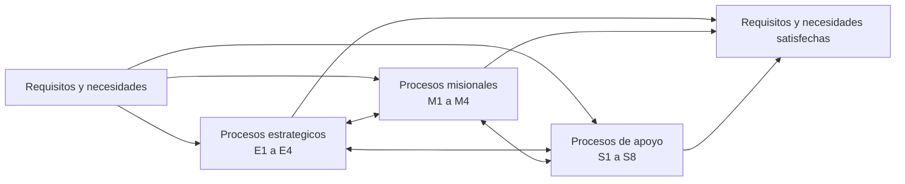

# Mapa de procesos Nivel 0

Esta nota transcribe el mapa institucional Nivel 0 para que pueda consultarse sin abrir el PDF. Registra cuatro procesos estrategicos, cuatro misionales y ocho de apoyo; S4 Gestion de las inversiones pertenece al grupo de apoyo.

> [!info] Estado de la transcripcion
> Es una representacion de trabajo obtenida de la fuente institucional. No reemplaza el original ni acredita por si sola su acto de aprobacion o vigencia.

## Identificacion de la fuente

| Campo | Valor observado |
|---|---|
| Documento | Mapa de Procesos Nivel 0 |
| Version | 3.0 |
| Unidad indicada | Gerencia Regional de Planeamiento, Presupuesto y Acondicionamiento Territorial; Sub Gerencia de Modernizacion y Transformacion Digital |
| Ubicacion precisa | Pagina PDF 1 de 1 |
| Fecha de consulta | 2026-10-15 |
| Vigencia | Por confirmar |
| SHA-256 | `4918B636122C9AF3825B159EF89B75C26FE6189FA908EDBB162ECAE046FF374F` |
| Original inmutable | [mapa-procesos-grh-nivel-0.pdf](../01-referencias/01-institucionales-grh/originales/mapa-procesos-grh-nivel-0.pdf) |

## Entradas y resultado global

| Posicion | Texto observado |
|---|---|
| Entrada | Requisitos y necesidades de las personas que reciben los bienes y servicios de la entidad |
| Resultado | Requisitos y necesidades de las personas que reciben los bienes y servicios de las entidades satisfechas |

## Procesos estrategicos

| Codigo | Denominacion observada |
|---|---|
| E1 | Direccionamiento estrategico |
| E2 | Gestion del desarrollo y modernizacion institucional |
| E3 | Gestion de alianzas y posicionamiento institucional |
| E4 | Gestion del sistema de control interno y la integridad institucional |

## Procesos misionales

| Codigo | Denominacion observada |
|---|---|
| M1 | Gestion del desarrollo social |
| M2 | Gestion de la competitividad economica y productiva |
| M3 | Integracion territorial regional |
| M4 | Gestion ambiental y de riesgo de desastres |

## Procesos de apoyo

| Codigo | Denominacion observada |
|---|---|
| S1 | Gestion del recurso humano |
| S2 | Gestion contable y financiera |
| S3 | Gestion de bienes y servicios |
| S4 | [Gestion de las inversiones](s4-gestion-de-las-inversiones.md) |
| S5 | Gestion de transformacion digital |
| S6 | Gestion de asuntos legales |
| S7 | Gestion de archivo |
| S8 | Gestion de transparencia y atencion al ciudadano |

## Vista estructural derivada

La vista siguiente resume la estructura y las interacciones graficas generales observadas. Es una vista Mermaid para navegacion; no es BPMN y no establece secuencia operativa.

## Calidad y limites de uso

- Evidencia observada: codigos, denominaciones, agrupacion y version se leen en la unica pagina del original.
- EVIDENCIA-INSUFICIENTE: la pagina no identifica el acto aprobatorio, la fecha de aprobacion ni una fecha de vigencia.
- La orientacion visual del PDF dificulta la lectura directa, pero su capa de texto es utilizable; no fue necesario aplicar OCR.
- Las flechas del mapa expresan interaccion general entre agrupaciones. No deben interpretarse como flujo BPMN, dependencia contractual ni orden temporal.

## Relaciones

- [Inventario de procesos](inventario-procesos.md)
- [S4 Gestion de las inversiones](s4-gestion-de-las-inversiones.md)
- [Arquitectura de procesos](README.md)
