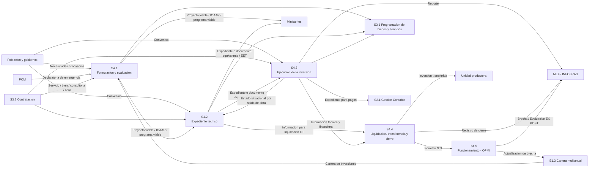

# S4 Gestion de las inversiones

Esta nota transcribe la ficha institucional de S4, su descomposicion Nivel 1, sus intercambios y sus tres fichas de indicadores. Constituye una fuente de consulta estructurada para el futuro modelamiento de S4.3, pero no contiene aun la descomposicion propuesta por el equipo.

> [!info] Estado de la transcripcion
> Contenido observado en la fuente institucional y pendiente de revision humana. Se preservan las denominaciones y aparentes errores del original cuando son relevantes; las discrepancias se registran expresamente al final.

## Identificacion documental

| Campo | Valor observado |
|---|---|
| Documento | Ficha del proceso Nivel 0 S4 y fichas de indicadores |
| Codigo del mapa | SGMD-MP-003 |
| Version | 3.0 |
| Ubicacion precisa | Paginas PDF 1-7; paginas impresas 120-126 |
| Fecha de consulta | 2026-10-15 |
| Vigencia | Por confirmar |
| SHA-256 | `F86C31E6A6BDFFBDBF7D5186BFD21E1FD58522BC546E0127296BD8C461931F83` |
| Original inmutable | [s4-gestion-inversion.pdf](../01-referencias/01-institucionales-grh/originales/s4-gestion-inversion.pdf) |

### Calidad tecnica de la fuente

- Las siete paginas poseen una capa de texto utilizable; no se aplico OCR.
- Las siete paginas fueron renderizadas e inspeccionadas visualmente para contrastar estructura, tablas y diagrama.
- La pagina impresa 123 contiene el diagrama principalmente como grafico; sus relaciones se contrastaron con las tablas de las paginas impresas 120-121.
- La legibilidad es suficiente para consulta y transcripcion, pero las discrepancias documentales enumeradas mas adelante impiden tratar esta nota como linea base validada.

## Ficha del proceso Nivel 0

| Campo | Transcripcion observada |
|---|---|
| Nombre del proceso | S4. Gestion de las inversiones |
| Version | 3.0 |
| Objetivo | Determinar el uso adecuado de los recursos publicos destinados a la inversion para la efectiva prestacion de servicios y la provision de la infraestructura necesaria en el plazo previsto alineados al cierre de brechas. |
| Tipo de proceso | Apoyo |
| Objetivo estrategico | OEI. 06 Garantizar una gestion institucional orientada al ciudadano. |
| Accion estrategica | AEI.06.10 Procesos administrativos eficientes en inversiones para Infraestructura en el departamento de Huanuco. |

### Dueno del proceso

- Gerencia Regional de Infraestructura.
  - Sub Gerencia de Estudios.
  - Sub Gerencia de Gestion de Obras y Supervision.
  - Sub Gerencia de Liquidacion.
- Gerencia Regional de Planeamiento y Presupuesto y Acondicionamiento Territorial.
  - Sub Gerencia de Formulacion y Evaluacion de Estudios de Pre-Inversion.
  - Sub Gerencia de Programacion Multianual de Inversiones.
- Gerencia Regional de Recursos Naturales y Gestion Ambiental.
  - Sub Gerencia de Recursos Naturales.
  - Sub Gerencia de Gestion Ambiental.
- Gerencia Regional de Desarrollo Economico.
  - Sub Gerencia de la Inversion Privada Sostenible.
- Direccion Regional de Transportes y Comunicaciones.
- Direccion Regional de Vivienda, Construccion y Saneamiento.
- Direccion Regional de Salud.
- Direccion Regional de Agricultura.
- Direccion Regional de Energia y Minas.

## Descomposicion observada en Nivel 1

| Codigo | Proceso | Responsable observado |
|---|---|---|
| S4.1 | Formulacion y evaluacion de programa/proyectos de inversion y registro y aprobacion de IOARR | Sub Gerencia de Formulacion y Evaluacion de Estudios de Pre-Inversion; unidades formuladoras que pertenecen al GRH |
| S4.2 | Elaboracion del expediente tecnico, documento equivalente y/o especificaciones tecnicas | Sub Gerencia de Estudios; unidades ejecutoras que pertenecen al GRH |
| S4.3 | Ejecucion de la inversion | Sub Gerencia de Gestion de Obras y Supervision; unidades ejecutoras que pertenecen al GRH |
| S4.4 | Liquidacion, transferencia y cierre de inversion | Sub Gerencia de Liquidacion; unidades ejecutoras que pertenecen al GRH |
| S4.5 | Funcionamiento - OPMI | Sub Gerencia de Programacion Multianual de Inversiones |

## Intercambios observados

Las filas siguientes estructuran la tabla de las paginas impresas 120-121. Describen proveedores, entradas, productos y receptores; no agregan actividades ni una secuencia que la fuente no declare.

### S4.1 Formulacion y evaluacion

| Sentido | Contraparte | Elemento observado |
|---|---|---|
| Entrada | Poblacion y Gobiernos Nacional, Regional y Local | Necesidades / Convenios |
| Entrada | PCM | Declaratoria de estados de emergencias |
| Entrada | E1.3 Desarrollo de la cartera de inversiones multianual | Cartera de inversiones |
| Entrada | S3.2 Contratacion de bienes y servicios | Servicio contratado |
| Salida | MINISTERIOS | Proyecto de inversion viable / IOAAR aprobado / Programas de inversion viable |
| Salida | S3.1 Programacion de bienes y servicios | Designacion de personal tecnico y/o requerimiento de contratacion de servicio |
| Salida | S4.2 Elaboracion del expediente tecnico, documento equivalente y/o especificaciones tecnicas | Proyecto de inversion viable / IOAAR aprobado / Programas de inversion viable |

### S4.2 Elaboracion del expediente tecnico

| Sentido | Contraparte | Elemento observado |
|---|---|---|
| Entrada | S3.2 Contratacion de bienes y servicios | Servicio contratado |
| Entrada | Gobiernos Nacional, Regional y Local | Convenios |
| Entrada | S4.1 Formulacion y evaluacion | Proyecto de inversion viable / IOAAR aprobado / Programas de inversion viable |
| Entrada | S4.3 Ejecucion de la inversion | Informe de estado situacional del Proyecto/programa o IOARR por saldo de obra |
| Salida | S3.1 Programacion de bienes y servicios | Designacion de personal tecnico y/o requerimiento de contratacion de servicio |
| Salida | MINISTERIOS | Expediente tecnico, documento equivalente aprobado y/o EET |
| Salida | S4.3 Ejecucion de la inversion | Expediente tecnico, documento equivalente aprobado y/o EETT |
| Salida | S4.4 Liquidacion, transferencia y cierre de la inversion | Informacion tecnico y financiero para liquidacion ET |

### S4.3 Ejecucion de la inversion

| Sentido | Contraparte | Elemento observado |
|---|---|---|
| Entrada | S4.2 Elaboracion del expediente tecnico | Expediente tecnico, documento equivalente aprobado y/o EETT |
| Entrada | Gobiernos Nacional, Regional y Local | Convenios |
| Entrada | S3.2 Contratacion de bienes y servicios | Servicio contratado / bien adquirido / consultoria y obra contratada |
| Salida | S3.1 Programacion de bienes y servicios | Designacion de personal y/o requerimiento de contratacion de consultoria de obra/bienes y servicios |
| Salida | MEF / INFOBRAS | Reporte de inversiones ejecutadas |
| Salida | S2.1 Gestion Contable | Expediente para pagos |
| Salida | S4.4 Liquidacion, transferencia y cierre de inversion | Informacion tecnico y financiero para liquidacion ET |
| Salida | S4.2 Elaboracion del expediente tecnico | Informe de estado situacional del Proyecto/programa o IOARR por saldo de obra |

### S4.4 Liquidacion, transferencia y cierre

| Sentido | Contraparte | Elemento observado |
|---|---|---|
| Entrada | S4.2 Elaboracion del expediente tecnico | Informacion tecnico y financiero para liquidacion ET |
| Entrada | S4.3 Ejecucion de la inversion | Informacion tecnico y financiero de la inversion |
| Salida | MEF | Registro de cierre de inversion |
| Salida | Unidad productora | Inversion transferida |
| Salida | S4.5 Funcionamiento - OPMI | Formato N°9. cierre de la inversion |

### S4.5 Funcionamiento - OPMI

| Sentido | Contraparte | Elemento observado |
|---|---|---|
| Entrada | S4.4 Liquidacion, transferencia y cierre de inversion | Formato N°9. cierre de la inversion |
| Salida | MEF | Actualizacion de brecha del diagnostico |
| Salida | MEF | Evaluacion EX POST |
| Salida | E1.3 Desarrollo de la cartera de inversiones multianual | Actualizacion de brecha del diagnostico |

## Vista de relaciones derivada

Esta vista reproduce las relaciones principales observadas en la tabla y en el diagrama de la pagina impresa 123. Es un indice visual Mermaid, no un modelo BPMN ni una declaracion de orden temporal.

## Indicadores observados

### S4-IND-1 Proyectos declarados viables

| Campo | Transcripcion observada |
|---|---|
| Producto | Proyecto de inversion viable / IOAAR aprobado / Programas de inversion viable |
| Nombre | Porcentaje de proyectos de inversion declarados viables en el plazo previsto con Metodologia convencional |
| Tipo | Misional |
| Justificacion | Medir el numero de Estudios de Pre Inversion Viables y/o Aprobados con la Metodologia Convencional |
| Responsable de medicion | Sub Gerencia de Formulacion y Evaluacion de Estudios de Pre Inversion |
| Responsable de la accion | Gerencia Regional de Planeamiento, Presupuesto y Acondicionamiento Territorial (GRPPAT) |
| Formula | `(PAA/PCA) x 100` |
| PAA | Numero de Estudios de Pre Inversion Viables y/o Aprobados en el año |
| PCA | Numero de Procesos PAC convocados oportunamente |
| Especificacion | Metodologia Convencional: la formulacion de proyecto consiste en analizar y valorar viabilidad, rentabilidad y sostenibilidad, considerando aspectos tecnicos, economicos, sociales y ambientales |
| Sentido / unidad / frecuencia | Ascendente / porcentaje / anual |
| Fuente de datos | Inventario de proyectos de la Sub Gerencia de Estudios de Pre Inversion |
| Ubicacion precisa | Pagina PDF 5; pagina impresa 124 |

| Año | 2024 | 2025 | 2026 | 2027 | 2028 |
|---|---:|---:|---:|---:|---:|
| Valor | 70% | 73% | 76% | 78% | 80% |

### S4-IND-2 Obras ejecutadas y culminadas

| Campo | Transcripcion observada |
|---|---|
| Producto | Inversion transferida |
| Nombre | Porcentaje de obras de Inversion Publica ejecutadas y culminadas en el año con acta de recepcion conforme |
| Tipo | Misional |
| Justificacion | Medir la eficiencia de ejecucion de obras de proyectos de inversion publica culminadas con acta de recepcion conforme ejecutadas en el año, ampliando la Infraestructura de Servicios en el ambito del Gobierno Regional Huanuco |
| Responsable de medicion | Sub Gerencia de Obras y Supervision |
| Responsable de la accion | Gerencia Regional de Infraestructura |
| Formula | `(NOC/NOP) x 100` |
| NOC | Numero de obras culminadas con acta de recepcion en el año |
| NOP | Numero de obras programados para ejecutar en el año |
| Especificacion | Considera obras nuevas, de continuidad, saldos de obra y otras, aprobadas mediante acta de recepcion |
| Sentido / unidad / frecuencia | Ascendente / porcentaje / anual |
| Fuente de datos | Control y seguimiento de la programacion de la SGOS; consulta amigable del SIAF de la ejecucion del gasto; evaluaciones del POI; actas de recepcion conforme |
| Ubicacion precisa | Pagina PDF 6; pagina impresa 125 |

| Año | 2024 | 2025 | 2026 | 2027 | 2028 |
|---|---:|---:|---:|---:|---:|
| Valor | 32.23% | 40.50% | 47.93% | 56.20% | 64.46% |

### S4-IND-3 Proyectos cerrados

| Campo | Transcripcion observada |
|---|---|
| Producto | Formato N°9. cierre de la inversion |
| Nombre | Porcentaje de proyectos de inversion publica cerrados en el año |
| Tipo | Misional |
| Justificacion | Medir la eficiencia del cierre de proyectos de inversion programados en el año, para ampliar y mejorar la Infraestructura de Servicios en el ambito del Gobierno Regional Huanuco |
| Responsable de medicion | Sub Gerencia de Liquidacion |
| Responsable de la accion | Gerencia Regional de Infraestructura |
| Formula | `(N/D) x 100` |
| N | Numero de proyectos de inversion a cerrar en el año |
| D | Numero de proyectos de inversion programados para cerrar en el año |
| Especificacion | Para el cierre se consideran la liquidacion de cada componente del proyecto —expediente tecnico, ejecucion, supervision, gestion administrativa y mobiliarios—, el pago de saldos a favor y la transferencia |
| Sentido / unidad / frecuencia | Ascendente / porcentaje / anual |
| Fuente de datos | Control y seguimiento de la programacion de la SGL; consulta amigable del SIAF; evaluacion del POI; resoluciones de liquidacion de todos los componentes; tramite de cierre en Invierte.pe |
| Ubicacion precisa | Pagina PDF 7; pagina impresa 126 |

| Año | 2024 | 2025 | 2026 | 2027 | 2028 |
|---|---:|---:|---:|---:|---:|
| Valor | 48% | 55% | 63% | 71% | 82% |

## Discrepancias y controles pendientes

| Hallazgo observado | Tratamiento |
|---|---|
| El encabezado de la pagina impresa 120 dice `S4. Gestion de la inversion`, mientras el campo nombre dice `S4. Gestion de las inversiones`. | Se usa el nombre del campo estructurado y se conserva la discrepancia para validacion. |
| El proceso S4 figura como tipo `Apoyo`, pero las tres fichas califican sus indicadores como `Misional`. | No se armoniza sin decision institucional. |
| La denominacion del proceso usa `IOARR`, mientras varios productos dicen `IOAAR`. | Se conservan ambos textos tal como aparecen; requiere correccion o confirmacion humana. |
| El diagrama usa algunos prefijos `PA` para procesos que la ficha identifica como `S`. | La tabla estructurada usa los codigos de la ficha; el diagrama original debe revisarse antes de una linea base. |
| La seccion de indicadores de la pagina impresa 122 enumera solo S4-IND-1, pero las paginas siguientes contienen S4-IND-1, S4-IND-2 y S4-IND-3. | Se registran los tres y se mantiene el hallazgo. |
| Los campos Elaborado por, Revisado por y Aprobado por aparecen sin nombres visibles. | EVIDENCIA-INSUFICIENTE para atribuir autoria, revision o aprobacion. |
| La fuente no muestra en estas paginas el acto aprobatorio ni una fecha de vigencia. | EVIDENCIA-INSUFICIENTE; debe localizarse el control documental o acto correspondiente. |

## Limites para el modelamiento

- Esta nota representa AS-IS documental observado; no es el AS-IS operativo validado con especialistas.
- No se han inferido actividades internas de S4.3, responsables adicionales, compuertas, eventos, plazos, reglas contractuales ni requisitos BIM.
- La primera descomposicion de S4.3 debe incorporar la propuesta del equipo como una nota de analisis separada y contrastarla con evidencia y normas antes de promoverla a linea base.
- Cuando se modele, el BPMN 2.0 XML sera la fuente maestra; cualquier SVG, PDF, Mermaid o Canvas sera una vista derivada.

## Relaciones

- [Mapa de procesos Nivel 0](mapa-procesos-nivel-0.md)
- [Inventario de procesos](inventario-procesos.md)
- [Metodologia de modelamiento](../00-gobernanza/metodologia-modelamiento.md)
- [Modelamiento de niveles siguientes](../03-modelamiento/README.md)
