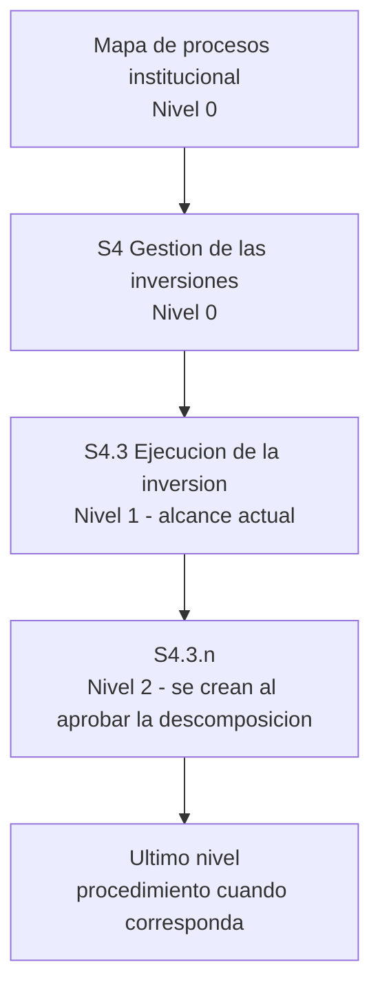

# Procesos

[Inicio](../00-inicio.md)

Esta area reune la documentacion de cada proceso tal como la organiza la Norma Tecnica de gestion por procesos (NT 002-2025-PCM-SGP): por niveles, con codigo y con su juego de documentos. El alcance actual es **S4.3 Ejecucion de la inversion**.

## Como leer el arbol

1. **Cada carpeta es un proceso.** Su nombre empieza por el codigo NT (`s4`, `s4-3`, `s4-3-1`). Los subprocesos son subcarpetas.
2. **Cada proceso tiene el mismo juego de documentos**, siempre con el codigo al inicio del nombre:

| Documento | Archivo | Referencia NT |
|---|---|---|
| Portada | `README.md` | - |
| Ficha de producto y proceso | `<codigo>-ficha-producto-proceso.md` | Numeral 6.1.3 a; Anexo 2 |
| Fichas de indicador | `<codigo>-fichas-indicador.md` | Numeral 6.1.3 b; Anexo 4 |
| Diagrama del proceso | `<codigo>-diagrama-proceso-logico.puml` o `<codigo>-diagrama-proceso.bpmn`, con su `.svg` derivado | Anexo 3 |
| Procedimiento | `<codigo>-procedimiento.md`, solo en el ultimo nivel y si cumple los criterios | Numeral 6.1.3 d; Anexos 7 y 8 |
| Sustento | `<codigo>-sustento.md`: fuentes, evidencias, discrepancias e historial de revision; no se exporta | Control del proyecto |
| Variacion de un documento aprobado | `<codigo>-<documento>-propuesta.md` | Control del proyecto |

3. **El estado esta en los metadatos de cada archivo**, no en carpetas. Todo lo no aprobado es `PROPUESTA` y avanza por niveles de revision:

| Nivel de revision | Quien otorga la conformidad para avanzar |
|---|---|
| `ELABORACION` | Quien elabora el documento lo remite a revision del equipo |
| `REVISION-EQUIPO` | Un integrante del equipo como representante del equipo (declarativa) |
| `OPINION-TECNICA` | Sub Gerencia de Modernizacion y Transformacion Digital |
| `APROBACION` | Dueno del proceso |

Un documento `APROBADO` no se edita: para variarlo se crea su archivo `-propuesta`. La IA nunca registra conformidades ni asigna el estado `APROBADO`.

4. **El TO-BE vive en un arbol separado** con la misma jerarquia. En esta etapa esta pendiente.

Las reglas completas estan en el [estandar de artefactos](../00-gobernanza/estandar-artefactos-modelamiento.md) y en la decision `DEC-017` del [registro de decisiones](../00-gobernanza/registro-decisiones.md).

## Contenido

- [Mapa de procesos institucional](mapa-de-procesos-institucional/README.md): mapa Nivel 0 e inventario de productos y procesos.
- [S4 Gestion de las inversiones](s4-gestion-de-las-inversiones/README.md): proceso Nivel 0 aprobado.
  - [S4.3 Ejecucion de la inversion](s4-gestion-de-las-inversiones/s4-3-ejecucion-inversion/README.md): alcance actual del proyecto.
- [TO-BE](to-be/README.md): rediseno futuro, pendiente.

## Fuentes y metodo

- [Fuentes institucionales aprobadas](../01-referencias/01-institucionales-grh/originales/README.md)
- [Norma tecnica de gestion por procesos](../01-referencias/02-gestion-por-procesos/originales/README.md)
- [Metodologia de modelamiento](../00-gobernanza/metodologia-modelamiento.md)
- [Plantillas de procesos](../00-gobernanza/plantillas/README.md)
