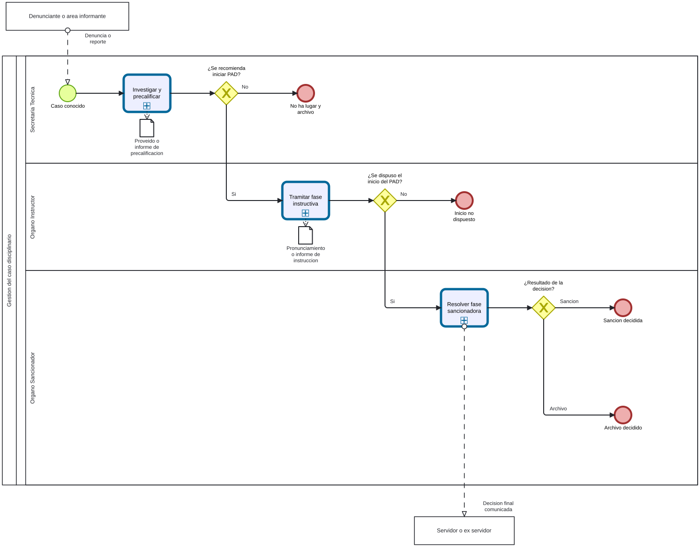

# Caso PAD - Ficha de producto y proceso candidata

Sube a: [Modelos BPMN de trabajo para el PAD](00-modelos-pad.md)

Ficha de trabajo con los campos del Anexo 2 de la NT. Corresponde al [modelo integral del caso](pad-trabajo-caso-diagrama-proceso-tabla.md), **no** a todo S1.4. Las clases, fuentes y discrepancias se registran en el [sustento del paquete](pad-trabajo-sustento.md). No se ha asignado codigo ni conformidad institucional.

## Nombre del proceso

EVIDENCIA-INSUFICIENTE para codigo y denominacion institucional. Nombre de trabajo: Gestion del Regimen Disciplinario y Procedimiento Administrativo Sancionador, mencionado en el borrador de directiva.

## Tipo de proceso

EVIDENCIA-INSUFICIENTE para el hijo PAD. La ficha aprobada clasifica a S1 como proceso de Apoyo; no se hereda automaticamente la clasificacion.

## Dueno del proceso

EVIDENCIA-INSUFICIENTE. La ficha S1 identifica a la Sub Gerencia de Gestion de Recursos Humanos como dueno de S1, pero no determina el dueno NT del hijo PAD.

## Objetivo del proceso

Propuesta para contrastar: conducir el caso disciplinario hasta un resultado documentado y comunicado, segun corresponda.

## Objetivo estrategico

EVIDENCIA-INSUFICIENTE: falta el instrumento de planeamiento y la vinculacion institucional del proceso candidato.

## Proveedor, elementos de entrada, producto y receptor

| Proveedor de elemento de entrada | Elementos de entrada | Producto | Receptor del producto |
|---|---|---|---|
| Denunciante, area informante o fuente de conocimiento de oficio, segun el caso | Denuncia, reporte o informe de control | Proveido de no ha lugar | EVIDENCIA-INSUFICIENTE: receptor y comunicacion aplicables |
| Secretaria Tecnica | Informe de precalificacion | Pronunciamiento motivado de no inicio, si corresponde | EVIDENCIA-INSUFICIENTE |
| Organo Instructor | Informe de instruccion | Acto de sancion notificado, si corresponde | Servidor o ex servidor; otros receptores por confirmar |
| Organo Instructor | Informe de instruccion | Acto de archivo notificado, si corresponde | Servidor o ex servidor; otros receptores por confirmar |

Los productos son alternativos; la tabla no afirma que todos ocurran en una misma instancia.

## Actividades del proceso

## Riesgos

EVIDENCIA-INSUFICIENTE: la ubicacion de esta unidad como proceso de ultimo nivel no esta definida. Los riesgos se consignaran aqui solo si corresponde a ese nivel.

## Registros

EVIDENCIA-INSUFICIENTE: la ubicacion de esta unidad como proceso de ultimo nivel no esta definida. Los registros se distinguiran de los productos cuando se confirme el nivel.

## Elaborado por, revisado por y aprobado por

| Elaborado por | Revisado por | Aprobado por |
|---|---|---|
| PENDIENTE | PENDIENTE | PENDIENTE |
