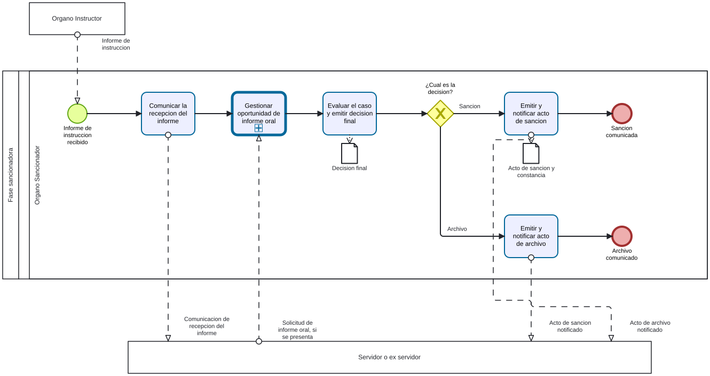

# Decision PAD - Ficha de producto y proceso candidata

Sube a: [Modelos BPMN de trabajo para el PAD](00-modelos-pad.md)

Ficha de trabajo con los campos del Anexo 2 para la [fase sancionadora diagramada](pad-trabajo-decision-diagrama-proceso-tabla.md). Su condicion de proceso y nivel esta pendiente. Fuentes y clases: [sustento](pad-trabajo-sustento.md).

## Nombre del proceso

EVIDENCIA-INSUFICIENTE para codigo y nombre institucional. Nombre de trabajo: Fase sancionadora del PAD.

## Tipo de proceso

EVIDENCIA-INSUFICIENTE.

## Dueno del proceso

EVIDENCIA-INSUFICIENTE. El Organo Sancionador es un rol del borrador cuya asignacion depende del caso; no se equipara automaticamente al dueno NT.

## Objetivo del proceso

Propuesta para contrastar: emitir y comunicar la decision final de sancion o archivo del caso.

## Objetivo estrategico

EVIDENCIA-INSUFICIENTE.

## Proveedor, elementos de entrada, producto y receptor

| Proveedor de elemento de entrada | Elementos de entrada | Producto | Receptor del producto |
|---|---|---|---|
| Organo Instructor | Informe de instruccion | Acto de sancion notificado, si corresponde | Servidor o ex servidor; otros receptores por confirmar |
| Organo Instructor | Informe de instruccion | Acto de archivo notificado, si corresponde | Servidor o ex servidor; otros receptores por confirmar |

Los dos productos son alternativos; el detalle de la notificacion requiere resolver las discrepancias del borrador.

## Actividades del proceso

## Riesgos

EVIDENCIA-INSUFICIENTE: confirmar ultimo nivel y levantar riesgos aplicables.

## Registros

EVIDENCIA-INSUFICIENTE: confirmar ultimo nivel y distinguir registros de productos. El borrador menciona constancias de notificacion.

## Elaborado por, revisado por y aprobado por

| Elaborado por | Revisado por | Aprobado por |
|---|---|---|
| PENDIENTE | PENDIENTE | PENDIENTE |
