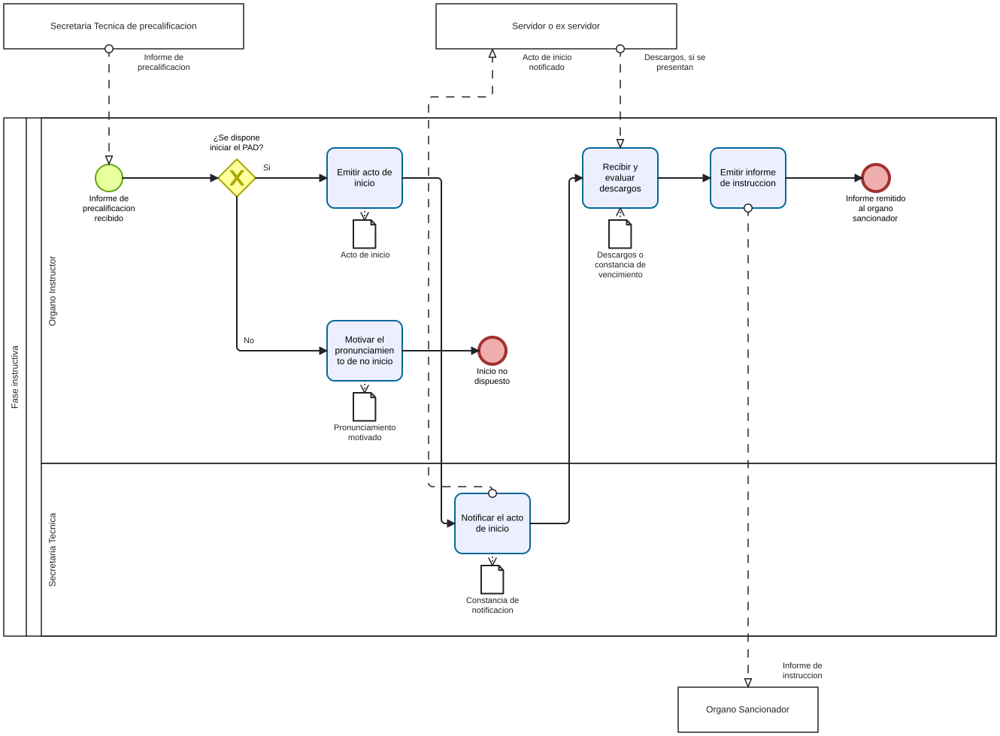

# Instruccion PAD - Ficha de producto y proceso candidata

Sube a: [Modelos BPMN de trabajo para el PAD](00-modelos-pad.md)

Ficha de trabajo con los campos del Anexo 2 para la [fase instructiva diagramada](pad-trabajo-instruccion-diagrama-proceso-tabla.md). Su condicion de proceso y nivel esta pendiente. Fuentes y clases: [sustento](pad-trabajo-sustento.md).

## Nombre del proceso

EVIDENCIA-INSUFICIENTE para codigo y nombre institucional. Nombre de trabajo: Fase instructiva del PAD.

## Tipo de proceso

EVIDENCIA-INSUFICIENTE.

## Dueno del proceso

EVIDENCIA-INSUFICIENTE. El Organo Instructor es un rol del borrador cuya asignacion depende del caso; no se equipara automaticamente al dueno NT.

## Objetivo del proceso

Propuesta para contrastar: sustanciar la fase instructiva y remitir un informe documentado al Organo Sancionador.

## Objetivo estrategico

EVIDENCIA-INSUFICIENTE.

## Proveedor, elementos de entrada, producto y receptor

| Proveedor de elemento de entrada | Elementos de entrada | Producto | Receptor del producto |
|---|---|---|---|
| Secretaria Tecnica | Informe de precalificacion | Pronunciamiento motivado de no inicio, si corresponde | EVIDENCIA-INSUFICIENTE |
| Secretaria Tecnica | Informe de precalificacion | Acto de inicio notificado | Servidor o ex servidor |
| Servidor o ex servidor | Descargos, si se presentan | Informe de instruccion | Organo Sancionador |

Los resultados de no inicio y de informe de instruccion corresponden a rutas alternativas.

## Actividades del proceso

## Riesgos

EVIDENCIA-INSUFICIENTE: confirmar ultimo nivel y levantar riesgos aplicables.

## Registros

EVIDENCIA-INSUFICIENTE: confirmar ultimo nivel y distinguir registros de productos. El borrador menciona constancias de notificacion y descargos.

## Elaborado por, revisado por y aprobado por

| Elaborado por | Revisado por | Aprobado por |
|---|---|---|
| PENDIENTE | PENDIENTE | PENDIENTE |
