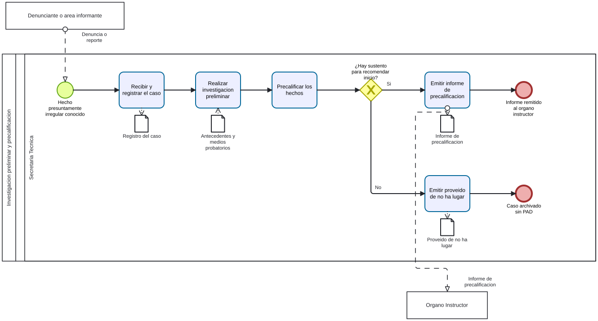

# Precalificacion PAD - Ficha de producto y proceso candidata

Sube a: [Modelos BPMN de trabajo para el PAD](00-modelos-pad.md)

Ficha de trabajo conforme a los campos del Anexo 2, vinculada al [modelo de precalificacion](pad-trabajo-precalificacion-diagrama-proceso-tabla.md). Aun no se ha decidido si esta unidad sera proceso de ultimo nivel o parte de otro proceso. Fuentes y clases: [sustento](pad-trabajo-sustento.md).

## Nombre del proceso

EVIDENCIA-INSUFICIENTE para codigo y nombre institucional. Nombre de trabajo: Investigacion preliminar y precalificacion.

## Tipo de proceso

EVIDENCIA-INSUFICIENTE.

## Dueno del proceso

EVIDENCIA-INSUFICIENTE. El borrador asigna actuaciones a la Secretaria Tecnica; esa funcion no equivale por si sola a la designacion de dueno NT.

## Objetivo del proceso

Propuesta para contrastar: determinar y documentar si los hechos conocidos sustentan recomendar el inicio del PAD.

## Objetivo estrategico

EVIDENCIA-INSUFICIENTE.

## Proveedor, elementos de entrada, producto y receptor

| Proveedor de elemento de entrada | Elementos de entrada | Producto | Receptor del producto |
|---|---|---|---|
| Denunciante, area informante o fuente de conocimiento de oficio, segun el caso | Denuncia, reporte o informe de control | Proveido de no ha lugar | EVIDENCIA-INSUFICIENTE para comunicacion y receptor |
| Denunciante, area informante o fuente de conocimiento de oficio, segun el caso | Denuncia, reporte o informe de control y actuaciones preliminares | Informe de precalificacion | Organo Instructor |

Los productos son resultados alternativos del modelo propuesto.

## Actividades del proceso

## Riesgos

EVIDENCIA-INSUFICIENTE: confirmar si esta unidad es de ultimo nivel y levantar riesgos con el equipo.

## Registros

EVIDENCIA-INSUFICIENTE: confirmar si esta unidad es de ultimo nivel y distinguir registros de productos. El borrador menciona registro del caso y antecedentes.

## Elaborado por, revisado por y aprobado por

| Elaborado por | Revisado por | Aprobado por |
|---|---|---|
| PENDIENTE | PENDIENTE | PENDIENTE |
