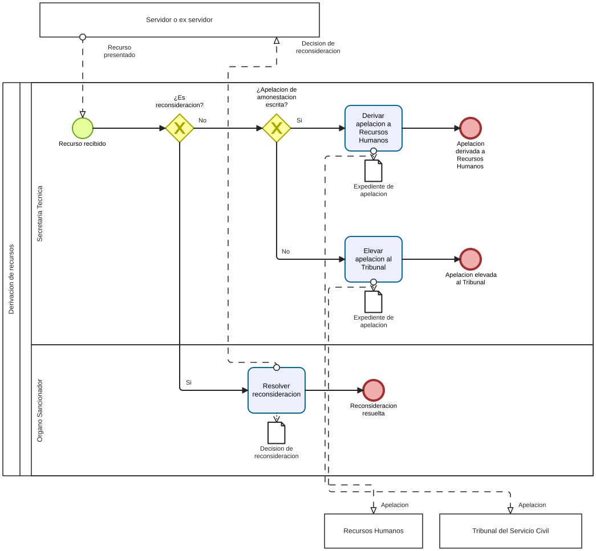

# Recursos PAD - Ficha de producto y proceso candidata

Sube a: [Modelos BPMN de trabajo para el PAD](00-modelos-pad.md)

Ficha de trabajo con los campos del Anexo 2 para la [derivacion de recursos diagramada](pad-trabajo-recursos-diagrama-proceso-tabla.md). Puede ser una interfaz del PAD en vez de un proceso propio; esa frontera esta pendiente. Fuentes y clases: [sustento](pad-trabajo-sustento.md).

## Nombre del proceso

EVIDENCIA-INSUFICIENTE para codigo, nombre institucional y condicion de proceso. Nombre de trabajo: Derivacion de recursos.

## Tipo de proceso

EVIDENCIA-INSUFICIENTE.

## Dueno del proceso

EVIDENCIA-INSUFICIENTE: intervienen roles de la Secretaria Tecnica y del Organo Sancionador; falta definir la titularidad del proceso o interfaz.

## Objetivo del proceso

Propuesta para contrastar: resolver la reconsideracion o encauzar la apelacion hacia la autoridad competente, segun el tipo de recurso.

## Objetivo estrategico

EVIDENCIA-INSUFICIENTE.

## Proveedor, elementos de entrada, producto y receptor

| Proveedor de elemento de entrada | Elementos de entrada | Producto | Receptor del producto |
|---|---|---|---|
| Servidor o ex servidor | Recurso de reconsideracion | Decision de reconsideracion | Servidor o ex servidor |
| Servidor o ex servidor | Apelacion relativa a amonestacion escrita | Expediente de apelacion derivado | Recursos Humanos, segun el borrador |
| Servidor o ex servidor | Otras apelaciones consideradas en el borrador | Expediente de apelacion elevado | Tribunal del Servicio Civil, segun el borrador |

No se modela ni se atribuye el tramite interno de la autoridad de segunda instancia.

## Actividades del proceso

## Riesgos

EVIDENCIA-INSUFICIENTE: confirmar si esta unidad es proceso de ultimo nivel o solo interfaz.

## Registros

EVIDENCIA-INSUFICIENTE: confirmar nivel y distinguir registros de productos. El borrador menciona expedientes de recurso.

## Elaborado por, revisado por y aprobado por

| Elaborado por | Revisado por | Aprobado por |
|---|---|---|
| PENDIENTE | PENDIENTE | PENDIENTE |
