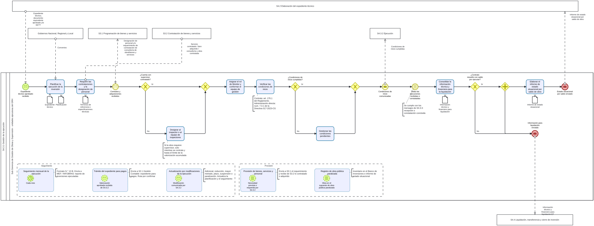

# S4.3.1 Gestion de la ejecucion - Ficha de producto y proceso

Sube a: [S4.3.1 Gestion de la ejecucion](00-S4-3-1-gestion-de-la-ejecucion.md)

<!-- Primer borrador (ELABORACION). Cada dato tiene su fuente y clase en S4-3-1-sustento.md. Los campos PENDIENTE requieren definicion del dueno del proceso. -->

## Nombre del proceso

S4.3.1 Gestion de la ejecucion

## Tipo de proceso

Apoyo

## Dueno del proceso

PENDIENTE. La ficha aprobada de S4 consigna como responsable de S4.3 a la Sub Gerencia de Gestion de Obras y Supervision y a las unidades ejecutoras que pertenecen al GRH; falta confirmar el dueno de S4.3.1.

## Objetivo del proceso

PENDIENTE de definicion por el dueno del proceso.

## Objetivo estrategico

PENDIENTE. La ficha aprobada de S4 se vincula a OEI.06 Garantizar una gestion institucional orientada al ciudadano y a AEI.06.10 Procesos administrativos eficientes en inversiones para Infraestructura en el departamento de Huanuco; falta confirmar si S4.3.1 se vincula al mismo objetivo.

## Proveedor, elementos de entrada, producto y receptor

| Proveedor de elemento de entrada | Elementos de entrada | Producto | Receptor del producto |
|---|---|---|---|
| S4.2 Elaboracion del expediente tecnico | Expediente tecnico, documento equivalente aprobado y/o EETT | Designacion de personal y/o requerimiento de contratacion de consultoria de obra/bienes y servicios | S3.1 Programacion de bienes y servicios |
| Gobiernos Nacional, Regional y Local | Convenios | Condiciones de inicio cumplidas | S4.3.2 Ejecucion |
| S3.2 Contratacion de bienes y servicios | Servicio contratado / bien adquirido / consultoria y obra contratada | Reporte de inversiones ejecutadas | MEF / INFOBRAS |
| S4.3.2 Ejecucion | Valorizacion aprobada | Expediente para pagos | S2.1 Gestion Contable |
| S4.3.2 Ejecucion | Modificaciones, plazos, suspensiones y paralizaciones comunicadas | Informacion tecnico y financiero para liquidacion ET | S4.4 Liquidacion, transferencia y cierre de inversion |
| S4.3.2 Ejecucion | Requerimientos de bienes, servicios o personal | Informe de estado situacional del Proyecto/programa o IOARR por saldo de obra | S4.2 Elaboracion del expediente tecnico |
| S4.3.3 Recepcion | Recepcion o constatacion concluida | | |

Las columnas de entradas y de productos se leen por separado: una misma fila no relaciona una entrada con un producto.

## Actividades del proceso

Procesos de nivel 3 candidatos, uno por subproceso de evento del diagrama: seguimiento mensual de la ejecucion, tramite del expediente para pagos, actualizacion por modificaciones de la ejecucion, provision de bienes, servicios y personal, y registro de obra publica paralizada. Sus codigos se asignaran cuando el equipo confirme la descomposicion.

## Riesgos

No aplica: S4.3.1 no es un proceso de ultimo nivel.

## Registros

No aplica: S4.3.1 no es un proceso de ultimo nivel.

## Elaborado por, revisado por y aprobado por

| Elaborado por | Revisado por | Aprobado por |
|---|---|---|
| PENDIENTE | PENDIENTE | PENDIENTE |
