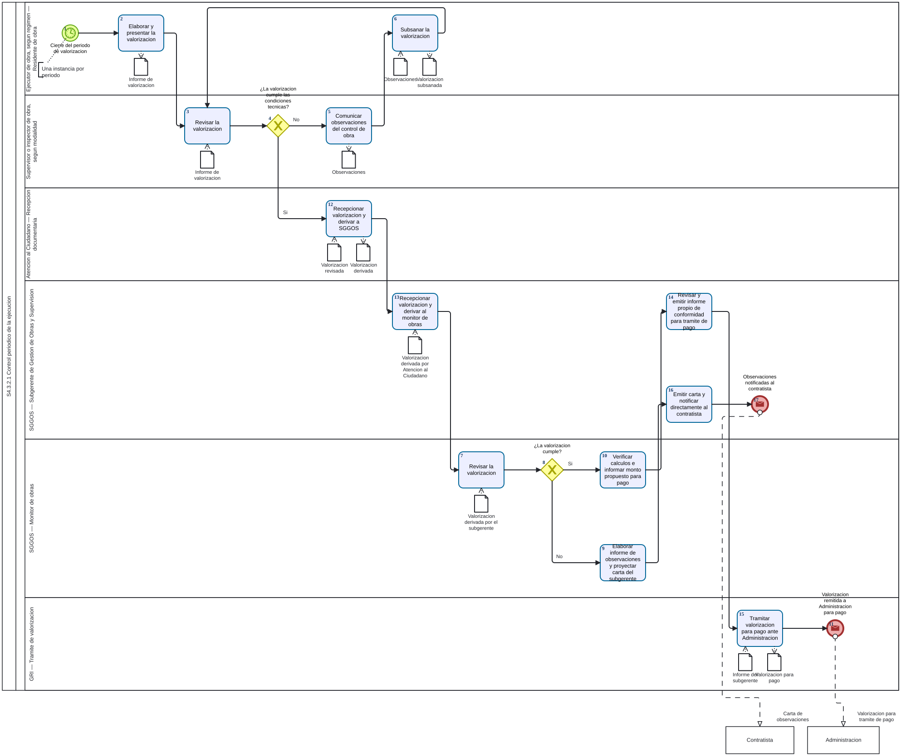

# S4.3.2.1 Control periodico de la ejecucion - Ficha de producto y proceso

Sube a: [S4.3.2.1 Control periodico de la ejecucion](00-S4-3-2-1-control-periodico-ejecucion.md)

## Nombre del proceso

S4.3.2.1 Control periodico de la ejecucion

## Tipo de proceso

Apoyo, pendiente de confirmacion con la arquitectura institucional.

## Dueno del proceso

`EVIDENCIA-INSUFICIENTE`. Debe confirmarse la unidad de organizacion con responsabilidad y autoridad para controlar y mejorar el proceso.

## Objetivo del proceso

Propuesta: verificar periodicamente el avance ejecutado y tramitar la valorizacion hacia Administracion para pago o comunicar al contratista las observaciones identificadas.

## Objetivo estrategico

`EVIDENCIA-INSUFICIENTE`. Pendiente confirmar su vinculacion con los instrumentos de planeamiento aplicables a S4.3.

## Proveedor, elementos de entrada, producto y receptor

| Proveedor de elemento de entrada | Elementos de entrada | Producto | Receptor del producto |
|---|---|---|---|
| Ejecutor de obra, segun regimen, mediante el residente | Metrados, avance ejecutado e informe de valorizacion del periodo | Valorizacion remitida para tramite de pago | Administracion, mediante la Gerencia Regional de Infraestructura |
| Supervisor o inspector de obra, segun modalidad | Revision, conformidad u observaciones | Observaciones comunicadas para subsanacion | Ejecutor de obra, segun regimen |
| Atencion al Ciudadano | Valorizacion recepcionada para tramite regular | Carta de observaciones notificada por el subgerente de SGGOS | Contratista |

## Actividades del proceso

En la propuesta del tramite regular, Atencion al Ciudadano deriva a SGGOS; el subgerente deriva al monitor de obras, responsable de la revision institucional (caja 7). El monitor verifica los calculos de penalidad, amortizacion, retenciones y demas conceptos que correspondan y los incorpora con el monto propuesto para pagar en su informe (caja 10); prepara tambien el proyecto de informe del subgerente. El subgerente revisa y emite su propio informe de conformidad (caja 14), con el que se eleva la valorizacion a GRI para tramitar el pago si cumple. El monitor prepara el informe de observaciones y proyecto de carta para notificacion directa al contratista si esta observado. La identificacion del dueno del proceso sigue pendiente.

## Riesgos

`EVIDENCIA-INSUFICIENTE`. Pendiente identificar y valorar riesgos con el dueno del proceso.

## Registros

Informe de valorizacion, informe del monitor, proyecto de informe del subgerente, informe propio de conformidad del subgerente para tramite de pago, informe de observaciones y carta al contratista, sujetos a confirmacion de denominacion y custodia.

## Elaborado por, revisado por y aprobado por

| Elaborado por | Revisado por | Aprobado por |
|---|---|---|
| PENDIENTE | PENDIENTE | PENDIENTE |

