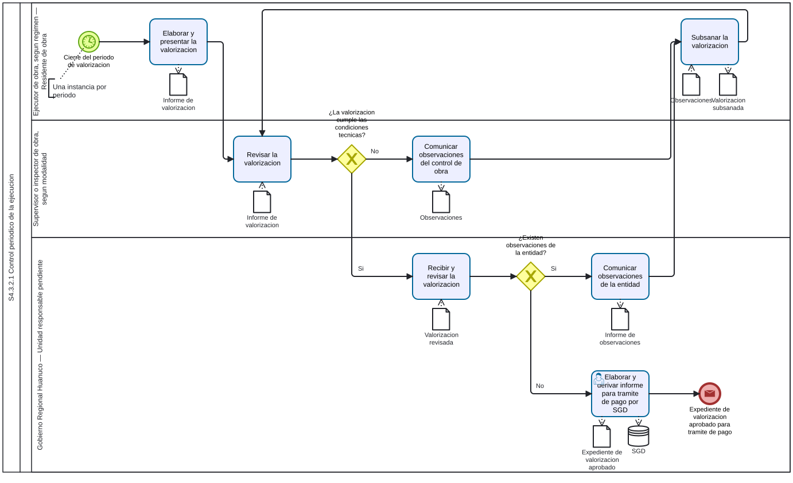

# S4.3.2.1 Control periodico de la ejecucion - Ficha de producto y proceso

Sube a: [S4.3.2.1 Control periodico de la ejecucion](00-S4-3-2-1-control-periodico-ejecucion.md)

## Nombre del proceso

S4.3.2.1 Control periodico de la ejecucion

## Tipo de proceso

Apoyo, pendiente de confirmacion con la arquitectura institucional.

## Dueno del proceso

`EVIDENCIA-INSUFICIENTE`. Debe confirmarse la unidad de organizacion con responsabilidad y autoridad para controlar y mejorar el proceso.

## Objetivo del proceso

Propuesta: verificar periodicamente el avance ejecutado y tramitar la valorizacion hasta obtener un expediente aprobado o comunicar las observaciones que deban ser subsanadas.

## Objetivo estrategico

`EVIDENCIA-INSUFICIENTE`. Pendiente confirmar su vinculacion con los instrumentos de planeamiento aplicables a S4.3.

## Proveedor, elementos de entrada, producto y receptor

| Proveedor de elemento de entrada | Elementos de entrada | Producto | Receptor del producto |
|---|---|---|---|
| Ejecutor de obra, segun regimen, mediante el residente | Metrados, avance ejecutado e informe de valorizacion del periodo | Expediente de valorizacion aprobado para tramite de pago | Proceso responsable del pago, por determinar |
| Supervisor o inspector de obra, segun modalidad | Revision, conformidad u observaciones | Observaciones comunicadas para subsanacion | Ejecutor de obra, segun regimen |

## Actividades del proceso

## Riesgos

`EVIDENCIA-INSUFICIENTE`. Pendiente identificar y valorar riesgos con el dueno del proceso.

## Registros

Informe de valorizacion, informe de observaciones e informe para tramite de pago, sujetos a confirmacion de denominacion y custodia.

## Elaborado por, revisado por y aprobado por

| Elaborado por | Revisado por | Aprobado por |
|---|---|---|
| PENDIENTE | PENDIENTE | PENDIENTE |

