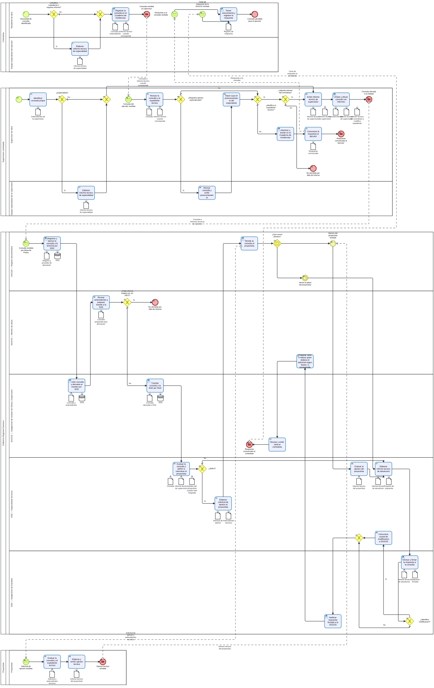

# S4.3.2.2 Atencion de consultas de obra - Ficha de producto y proceso

Sube a: [S4.3.2.2 Atencion de consultas de obra](00-S4-3-2-2-atencion-consultas-obra.md)

## Nombre del proceso

S4.3.2.2 Atencion de consultas de obra

## Tipo de proceso

Apoyo, pendiente de confirmacion con la arquitectura institucional.

## Dueno del proceso

Propuesta: Sub Gerencia de Estudios. El ROF le asigna absolver las consultas sobre ocurrencias en la ejecucion de obra y `DEC-033` precisa que su Subgerente firma la respuesta. La condicion de dueno debe ser confirmada en el circuito institucional de revision.

## Objetivo del proceso

Propuesta: absolver y comunicar oportunamente las consultas formuladas durante la ejecucion, obteniendo las opiniones tecnicas necesarias y derivando las modificaciones que se identifiquen.

## Objetivo estrategico

`EVIDENCIA-INSUFICIENTE`. Pendiente confirmar su vinculacion con los instrumentos de planeamiento aplicables a S4.3.

## Proveedor, elementos de entrada, producto y receptor

| Proveedor de elemento de entrada | Elementos de entrada | Producto | Receptor del producto |
|---|---|---|---|
| Contratista, mediante el residente y su equipo especialista cuando corresponda | Consulta registrada en el Cuaderno de Incidencias, antecedentes e informe tecnico cuando corresponda | Consulta absuelta y anotada por el supervisor solo si no modifica el expediente tecnico | Contratista |
| Supervision contratada, mediante el supervisor y su especialista cuando se requiere opinion | Consulta elevada, informe tecnico de supervision que contiene su evaluacion y opinion sobre la viabilidad de la consulta e informe tecnico del contratista obligatorio si modifica el expediente tecnico; o consulta originada por la supervision | Respuesta institucional firmada por el Subgerente de Estudios y comunicada a SGGOS | SGGOS |
| Proyectista, cuando corresponda | Opinion tecnica | Informe tecnico de absolucion y respuesta sustentada | SGGOS, para comunicacion al contratista |
| SGGOS | Respuesta firmada comunicada por SGE y bases de contratacion aplicables | Carta de respuesta al contratista que, si corresponde un adicional, comunica a quien corresponde elaborarlo segun las bases | Contratista |
| SGE | Respuesta que identifica una modificacion | Causal y antecedentes comunicados | S4.3.2.3 a S4.3.2.6, segun corresponda |

La consulta del contratista que modifica el expediente tecnico y carece de informe tecnico no se atiende; no constituye una consulta absuelta. Condiciones propuestas a partir de los numerales 190.1 y 190.2, con fuente, vigencia y limites en el [sustento](S4-3-2-2-sustento.md).

## Actividades del proceso

## Riesgos

`EVIDENCIA-INSUFICIENTE`. Pendiente identificar y valorar riesgos con el dueno del proceso.

## Registros

Consulta anotada, informe tecnico del contratista cuando corresponda, informe tecnico de supervision que contiene su evaluacion y opinion sobre la viabilidad de la consulta, opinion del proyectista cuando corresponda, informe tecnico de absolucion de los especialistas de la SGE, respuesta firmada por el Subgerente de Estudios y constancia de notificacion. La denominacion, serie documental y custodia permanecen pendientes de confirmacion.

El monitor prepara la carta de SGGOS conforme a la precision operativa del usuario del 2026-11-18. Su acto de emision y el responsable concreto del adicional, a identificar en las bases aplicables, permanecen pendientes de corroboracion; vease el [sustento](S4-3-2-2-sustento.md).

## Elaborado por, revisado por y aprobado por

| Elaborado por | Revisado por | Aprobado por |
|---|---|---|
| PENDIENTE | PENDIENTE | PENDIENTE |

