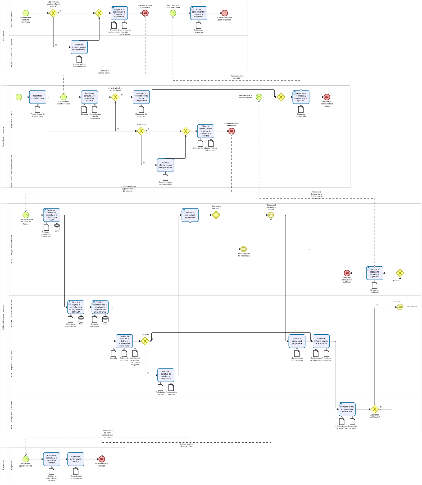

# S4.3.2.2 Atencion de consultas de obra - Ficha de producto y proceso

Sube a: [S4.3.2.2 Atencion de consultas de obra](00-S4-3-2-2-atencion-consultas-obra.md)

## Nombre del proceso

S4.3.2.2 Atencion de consultas de obra

## Tipo de proceso

Apoyo, pendiente de confirmacion con la arquitectura institucional.

## Dueno del proceso

Propuesta: Sub Gerencia de Estudios. El ROF le asigna absolver las consultas sobre ocurrencias en la ejecucion de obra y `DEC-033` precisa que su Subgerente firma la respuesta. La condicion de dueno debe ser confirmada en el circuito institucional de revision.

## Objetivo del proceso

Propuesta: absolver y comunicar oportunamente las consultas formuladas durante la ejecucion, obteniendo las opiniones tecnicas necesarias y derivando las modificaciones que se identifiquen.

## Objetivo estrategico

`EVIDENCIA-INSUFICIENTE`. Pendiente confirmar su vinculacion con los instrumentos de planeamiento aplicables a S4.3.

## Proveedor, elementos de entrada, producto y receptor

| Proveedor de elemento de entrada | Elementos de entrada | Producto | Receptor del producto |
|---|---|---|---|
| Ejecutor de obra por contrata, mediante el residente y su equipo especialista cuando corresponda | Consulta registrada en el Cuaderno de Incidencias, antecedentes e informe tecnico cuando corresponda | Consulta absuelta y comunicada | Ejecutor de obra por contrata; supervision contratada |
| Supervision contratada, mediante el supervisor de obra | Consulta elevada y opinion tecnica; o consulta originada por la supervision | Respuesta institucional firmada por el Subgerente de Estudios | Supervision contratada; ejecutor de obra por contrata |
| Proyectista, cuando corresponda | Opinion tecnica | Informe tecnico de absolucion y respuesta sustentada | Supervision contratada; ejecutor de obra por contrata |
| SGE | Respuesta que identifica una modificacion | Causal y antecedentes comunicados | S4.3.2.3 a S4.3.2.6, segun corresponda |

## Actividades del proceso

## Riesgos

`EVIDENCIA-INSUFICIENTE`. Pendiente identificar y valorar riesgos con el dueno del proceso.

## Registros

Consulta anotada, informe tecnico del contratista cuando corresponda, opinion tecnica del supervisor, opinion del proyectista cuando corresponda, informe tecnico de absolucion de los especialistas de la SGE, respuesta firmada por el Subgerente de Estudios y constancia de notificacion. La denominacion, serie documental y custodia permanecen pendientes de confirmacion.

## Elaborado por, revisado por y aprobado por

| Elaborado por | Revisado por | Aprobado por |
|---|---|---|
| PENDIENTE | PENDIENTE | PENDIENTE |

