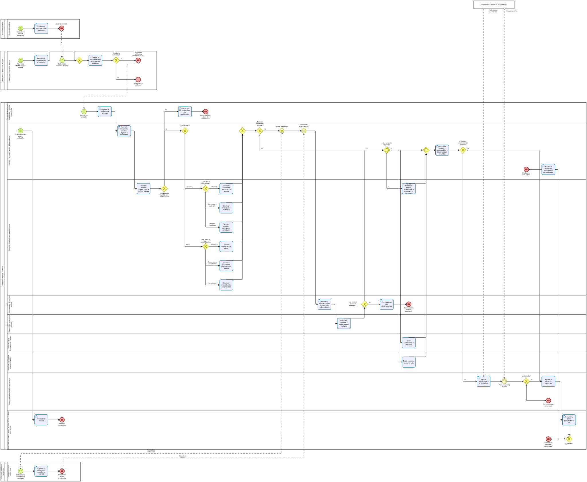

# S4.3.2.3 Gestion de modificaciones de alcance o plazo - Ficha de producto y proceso

Sube a: [S4.3.2.3 Gestion de modificaciones de alcance o plazo](00-S4-3-2-3-gestion-modificaciones-alcance-plazo.md)

## Nombre del proceso

S4.3.2.3 Gestion de modificaciones de alcance o plazo

## Tipo de proceso

Apoyo, pendiente de confirmacion con la arquitectura institucional.

## Dueno del proceso

`EVIDENCIA-INSUFICIENTE`. La SGGOS es candidata para conducir el seguimiento por los articulos 97-98 del ROF, pero la propiedad del proceso y la autoridad para decidir cada variante deben confirmarse. No se presume que una sola unidad firme todos los actos.

## Objetivo del proceso

Propuesta: gestionar de manera trazable las necesidades de modificar alcance, costo, plazo o condiciones de ejecucion de una obra, separando la validacion de la necesidad, la elaboracion, la revision tecnica competente e independiente, el control contractual y de costos, los controles complementarios y la decision de la autoridad que corresponda segun regimen, figura, umbral y delegacion.

## Objetivo estrategico

`EVIDENCIA-INSUFICIENTE`. Pendiente confirmar su vinculacion con los instrumentos de planeamiento aplicables a S4.3.

## Proveedor, elementos de entrada, producto y receptor

| Proveedor de elemento de entrada | Elementos de entrada | Producto | Receptor del producto |
|---|---|---|---|
| Residente, supervisor o inspector de obra, o S4.3.2.2 | Solicitud, necesidad o causal; asiento del cuaderno; informe y antecedentes tecnicos | Decision sobre la figura aplicable, registrada y comunicada | Residente, supervisor o inspector y unidades del GORE involucradas |
| Elaborador definido en las bases o designado por la OAD | Expediente tecnico de modificacion desarrollado o subsanado | Solucion tecnica documentada para revision institucional | SGE y SGGOS |
| SGE, control contractual y costos, Presupuesto, GRAJ o Contraloria, cuando corresponda | Opinion tecnica independiente, matriz contractual y de costos, disponibilidad presupuestal, revision legal o autorizacion externa | Expediente integrado para decision de la autoridad competente | GRI, SGGOS y autoridad competente |
| Autoridad competente segun figura, umbral y delegacion | Resolucion, acuerdo o autorizacion de pago | Modificacion aprobada, denegada o declarada improcedente y comunicada | Participantes de la ejecucion; Banco de Inversiones, INFOBRAS o Pladicop cuando corresponda |

## Actividades del proceso

## Riesgos

`EVIDENCIA-INSUFICIENTE`. Para la futura identificacion y valoracion deben considerarse, sin asignar aun nivel de riesgo: auto-revision del elaborador, falta de especialista competente, colusion entre participantes, aprobacion de mejoras no necesarias, reconocimiento como adicional de obligaciones originales, sustitucion por prestaciones inferiores, errores en metrados o precios, fraccionamiento y omision de acumulados o umbrales.

## Registros

Asiento o sustento de la causal en el cuaderno; informe de necesidad y riesgo de la supervision o inspeccion; definicion o designacion del elaborador; expediente tecnico de la modificacion cuando corresponda; informe del especialista tecnico independiente; matriz de alcance original, causal, modalidad de pago, metrados, precios y acumulados; opiniones presupuestal y legal aplicables; matriz de consolidacion y discrepancias; autorizacion de Contraloria cuando corresponda; resolucion, acuerdo, autorizacion de pago o documento de reinicio; registros en Banco de Inversiones, INFOBRAS o Pladicop; y constancia de comunicacion. En administracion directa, la modificacion aprobada puede producir posteriormente una actualizacion del plan de abastecimiento o un requerimiento, como interfaz fuera de este proceso. La composicion exacta debe confirmarse por variante.

## Elaborado por, revisado por y aprobado por

| Elaborado por | Revisado por | Aprobado por |
|---|---|---|
| PENDIENTE | PENDIENTE | PENDIENTE |

