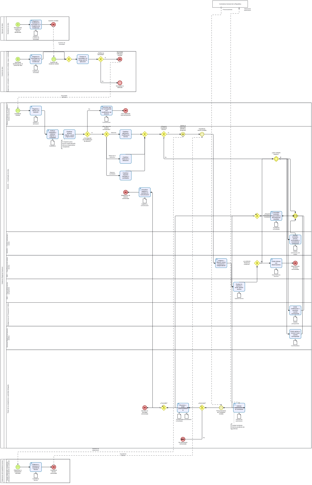

# S4.3.2.3 Gestion de modificaciones de alcance - Ficha de producto y proceso

Sube a: [S4.3.2.3 Gestion de modificaciones de alcance](00-S4-3-2-3-gestion-modificaciones-alcance.md)

## Nombre del proceso

S4.3.2.3 Gestion de modificaciones de alcance

## Tipo de proceso

Apoyo, pendiente de confirmacion con la arquitectura institucional.

## Dueno del proceso

`EVIDENCIA-INSUFICIENTE`. La SGGOS es candidata para conducir el seguimiento por los articulos 97-98 del ROF, pero la propiedad del proceso y la autoridad para decidir cada variante deben confirmarse. No se presume que una sola unidad firme todos los actos.

## Objetivo del proceso

Propuesta: gestionar de manera trazable las modificaciones de alcance de una obra, separando la validacion de la necesidad, la clasificacion inicial, la elaboracion, la revision tecnica competente e independiente, los controles complementarios y la decision del Titular de la competencia o autoridad delegada.

## Objetivo estrategico

`EVIDENCIA-INSUFICIENTE`. Pendiente confirmar su vinculacion con los instrumentos de planeamiento aplicables a S4.3.

## Proveedor, elementos de entrada, producto y receptor

| Proveedor de elemento de entrada | Elementos de entrada | Producto | Receptor del producto |
|---|---|---|---|
| Ejecutor de obra, segun regimen; supervisor o inspector de obra; S4.3.2.2 | Solicitud, necesidad o causal; registro en el Cuaderno de Incidencias; informe y antecedentes tecnicos | Decision sobre la modificacion de alcance, registrada y comunicada | Ejecutor de obra, segun regimen; supervisor o inspector de obra; unidades del GORE involucradas |
| Equipo elaborador definido en las bases o designado por la OAD, con adscripcion por confirmar | Expediente tecnico desarrollado o subsanado | Solucion tecnica documentada para revision institucional | SGE y SGGOS |
| Especialistas y controles competentes; Contraloria cuando corresponda | Opinion tecnica independiente, control contractual y de costos, disponibilidad presupuestal, revision legal o autorizacion externa | Expediente integrado para decision | Titular de la competencia o autoridad delegada |
| Titular de la competencia o autoridad delegada | Pronunciamiento formal | Modificacion aprobada, denegada o declarada improcedente y comunicada | Participantes de la ejecucion y sistemas aplicables |

## Actividades del proceso

## Riesgos

`EVIDENCIA-INSUFICIENTE`. Para la futura identificacion deben considerarse, sin asignar nivel: auto-revision del elaborador, falta de especialista competente, reconocimiento como adicional de obligaciones originales, mejoras no necesarias, errores en metrados o precios, fraccionamiento y omision de acumulados o umbrales.

## Registros

Registro de la causal en el Cuaderno de Incidencias; informe de necesidad; definicion o designacion del elaborador; expediente tecnico cuando corresponda; informe tecnico independiente; matriz de alcance original, causal, metrados, precios y acumulados; controles presupuestales y legales aplicables; autorizacion de Contraloria cuando corresponda; pronunciamiento formal; registros en los sistemas aplicables y constancia de comunicacion. La composicion exacta debe confirmarse por variante.

## Elaborado por, revisado por y aprobado por

| Elaborado por | Revisado por | Aprobado por |
|---|---|---|
| PENDIENTE | PENDIENTE | PENDIENTE |

