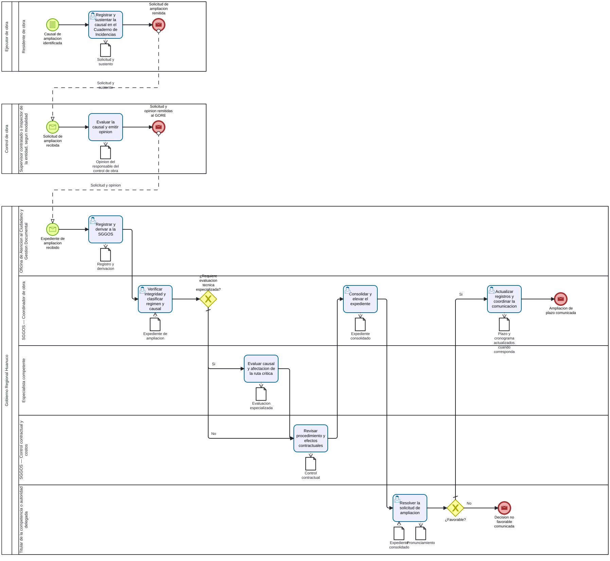

# S4.3.2.4 Gestion de ampliaciones de plazo - Ficha de producto y proceso

Sube a: [S4.3.2.4 Gestion de ampliaciones de plazo](00-S4-3-2-4-gestion-ampliaciones-plazo.md)

## Nombre del proceso

S4.3.2.4 Gestion de ampliaciones de plazo

## Tipo de proceso

Apoyo, pendiente de confirmacion con la arquitectura institucional.

## Dueno del proceso

`EVIDENCIA-INSUFICIENTE`. SGGOS es candidata para el seguimiento, pero la propiedad y la competencia decisoria deben confirmarse.

## Objetivo del proceso

Propuesta: evaluar y resolver de manera trazable las solicitudes o causales de ampliacion de plazo, separando el sustento de campo, la revision especializada, el control contractual, la consolidacion y la decision formal.

## Objetivo estrategico

`EVIDENCIA-INSUFICIENTE`.

## Proveedor, elementos de entrada, producto y receptor

| Proveedor de elemento de entrada | Elementos de entrada | Producto | Receptor del producto |
|---|---|---|---|
| Ejecutor de obra; control de obra; S4.3.2.2 cuando corresponda | Solicitud o causal, registro en el Cuaderno de Incidencias, sustento y opinion | Ampliacion aprobada o decision no favorable, comunicada | Participantes de la ejecucion y unidades del GORE involucradas |
| Especialista competente y control contractual | Evaluacion de causal, afectacion de ruta critica y cumplimiento del procedimiento | Expediente consolidado | Titular de la competencia o autoridad delegada |

## Actividades del proceso

## Riesgos

`EVIDENCIA-INSUFICIENTE`. Pendiente identificar y valorar riesgos con el dueno del proceso.

## Registros

Registro de causal, solicitud, opinion del responsable del control de obra, evaluacion especializada, control contractual, pronunciamiento, cronograma actualizado cuando corresponda y constancia de comunicacion; denominaciones y custodias pendientes.

## Elaborado por, revisado por y aprobado por

| Elaborado por | Revisado por | Aprobado por |
|---|---|---|
| PENDIENTE | PENDIENTE | PENDIENTE |

