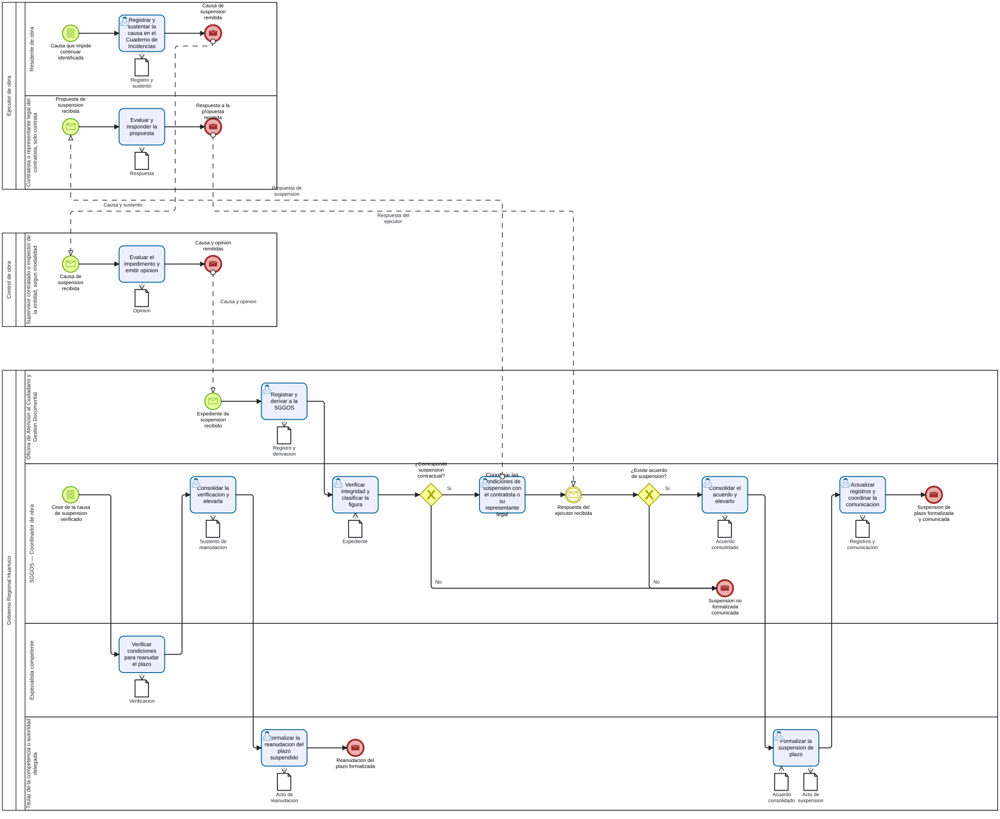

# S4.3.2.5 Formalizacion de suspensiones de plazo - Ficha de producto y proceso

Sube a: [S4.3.2.5 Formalizacion de suspensiones de plazo](00-S4-3-2-5-formalizacion-suspensiones-plazo.md)

## Nombre del proceso

S4.3.2.5 Formalizacion de suspensiones de plazo

## Tipo de proceso

Apoyo, pendiente de confirmacion con la arquitectura institucional.

## Dueno del proceso

`EVIDENCIA-INSUFICIENTE`.

## Objetivo del proceso

Propuesta: formalizar de manera trazable la suspension contractual del plazo y, cuando cese su causa, la reanudacion correspondiente, sin confundir la coordinacion de las partes, la verificacion tecnica y la decision formal.

## Objetivo estrategico

`EVIDENCIA-INSUFICIENTE`.

## Proveedor, elementos de entrada, producto y receptor

| Proveedor de elemento de entrada | Elementos de entrada | Producto | Receptor del producto |
|---|---|---|---|
| Contratista, mediante el residente y su representante legal cuando corresponda; supervisor o inspector de obra; entidad | Causa que impide continuar, registro en el Cuaderno de Incidencias, evaluacion y acuerdo de las partes | Suspension de plazo formalizada | Participantes de la ejecucion |
| Supervisor o inspector de obra; especialista competente cuando corresponda | Verificacion del cese de la causa | Reanudacion del plazo suspendido formalizada | Participantes de la ejecucion |

## Actividades del proceso

## Riesgos

`EVIDENCIA-INSUFICIENTE`.

## Registros

Registro de la causa, evaluacion, propuesta y respuesta de las partes, acto de suspension, verificacion del cese de la causa, acto de reanudacion y constancias de comunicacion; denominaciones y custodias pendientes.

## Elaborado por, revisado por y aprobado por

| Elaborado por | Revisado por | Aprobado por |
|---|---|---|
| PENDIENTE | PENDIENTE | PENDIENTE |

