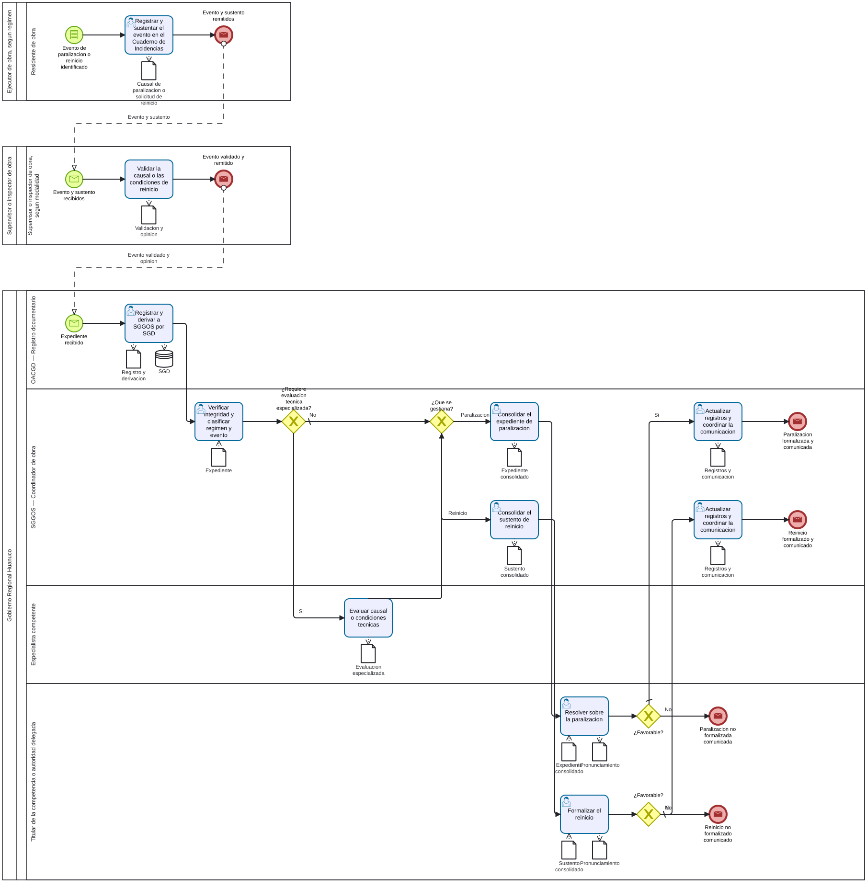

# S4.3.2.6 Gestion de paralizacion y reinicio - Ficha de producto y proceso

Sube a: [S4.3.2.6 Gestion de paralizacion y reinicio](00-S4-3-2-6-gestion-paralizacion-reinicio.md)

## Nombre del proceso

S4.3.2.6 Gestion de paralizacion y reinicio

## Tipo de proceso

Apoyo, pendiente de confirmacion con la arquitectura institucional.

## Dueno del proceso

`EVIDENCIA-INSUFICIENTE`.

## Objetivo del proceso

Propuesta: gestionar de manera trazable la paralizacion de una obra y su posterior reinicio, separando el registro y validacion de campo, la evaluacion especializada, la consolidacion y la decision formal.

## Objetivo estrategico

`EVIDENCIA-INSUFICIENTE`.

## Proveedor, elementos de entrada, producto y receptor

| Proveedor de elemento de entrada | Elementos de entrada | Producto | Receptor del producto |
|---|---|---|---|
| Ejecutor de obra y control de obra | Causal de paralizacion registrada y validada | Paralizacion formalizada o decision no favorable | Participantes de la ejecucion |
| Ejecutor de obra; control de obra; especialista competente cuando corresponda | Condiciones de reinicio registradas y verificadas | Reinicio formalizado o decision no favorable | Participantes de la ejecucion |

## Actividades del proceso

## Riesgos

`EVIDENCIA-INSUFICIENTE`.

## Registros

Registros en el Cuaderno de Incidencias, informes de causal y validacion, evaluacion especializada cuando corresponda, acto de paralizacion, sustento y acto de reinicio y constancias de comunicacion; denominaciones y custodias pendientes.

## Elaborado por, revisado por y aprobado por

| Elaborado por | Revisado por | Aprobado por |
|---|---|---|
| PENDIENTE | PENDIENTE | PENDIENTE |

