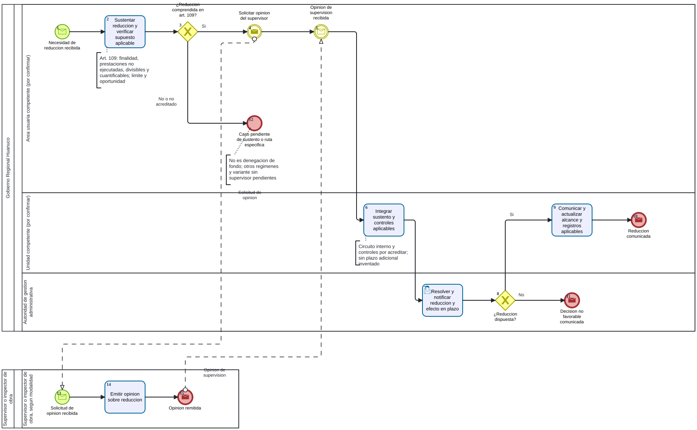

# S4.3.2.7 Gestion de reducciones de prestaciones - Ficha de producto y proceso

Sube a: [S4.3.2.7 Gestion de reducciones de prestaciones](00-S4-3-2-7-gestion-reducciones-prestaciones.md)

## Nombre del proceso

S4.3.2.7 Gestion de reducciones de prestaciones

## Tipo de proceso

Apoyo, pendiente de confirmacion.

## Dueno del proceso

EVIDENCIA-INSUFICIENTE. Pendiente confirmar unidad propietaria y autoridad competente.

## Objetivo del proceso

Gestionar la reduccion de prestaciones con sustento propio, opinion aplicable y decision formal. La reduccion de metas requiere clasificacion previa.

## Objetivo estrategico

EVIDENCIA-INSUFICIENTE. Pendiente vinculo con planeamiento.

## Proveedor, elementos de entrada, producto y receptor

| Proveedor de elemento de entrada | Elementos de entrada | Producto | Receptor del producto |
|---|---|---|---|
| Participantes de obra y unidad competente, segun sustento | Necesidad y sustento de reduccion | Decision de reduccion comunicada o caso pendiente de sustento | Ejecutor, supervision y unidades competentes |

## Actividades del proceso

## Riesgos

Pendientes de valoracion: confundir figuras contractuales, omitir controles o tratar autorizacion de ejecucion como autorizacion de pago.

## Registros

Necesidad y sustento de reduccion; sustento de clasificacion y pronunciamientos aplicables.

## Elaborado por, revisado por y aprobado por

| Elaborado por | Revisado por | Aprobado por |
|---|---|---|
| PENDIENTE | PENDIENTE | PENDIENTE |
