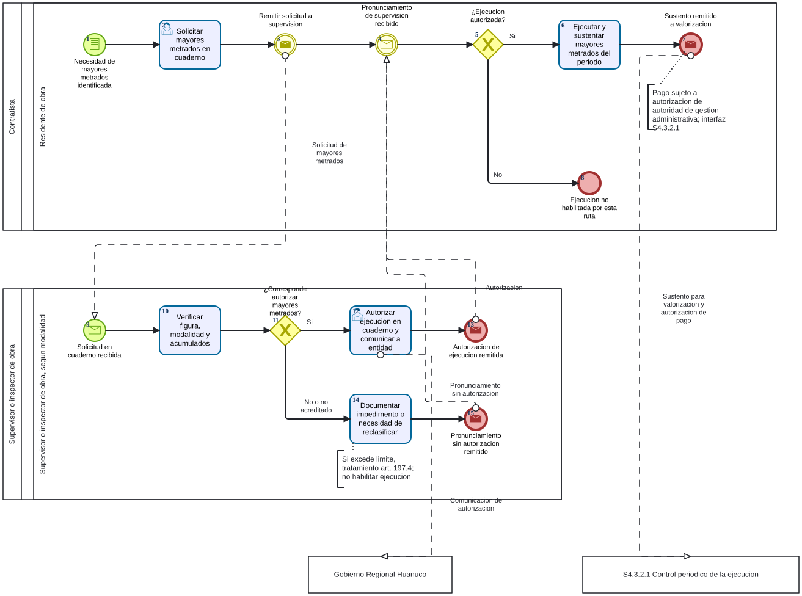

# S4.3.2.8 Gestion de mayores metrados - Ficha de producto y proceso

Sube a: [S4.3.2.8 Gestion de mayores metrados](00-S4-3-2-8-gestion-mayores-metrados.md)

## Nombre del proceso

S4.3.2.8 Gestion de mayores metrados

## Tipo de proceso

Apoyo, pendiente de confirmacion.

## Dueno del proceso

EVIDENCIA-INSUFICIENTE. Pendiente confirmar unidad propietaria y autoridad competente.

## Objetivo del proceso

Gestionar solicitud, control y autorizacion de ejecucion de mayores metrados y entregar su sustento al control periodico para valorizacion y autorizacion de pago.

## Objetivo estrategico

EVIDENCIA-INSUFICIENTE. Pendiente vinculo con planeamiento.

## Proveedor, elementos de entrada, producto y receptor

| Proveedor de elemento de entrada | Elementos de entrada | Producto | Receptor del producto |
|---|---|---|---|
| Participantes de obra y unidad competente, segun sustento | Solicitud en cuaderno, control de acumulados y sustento del periodo | Pronunciamiento de ejecucion y sustento para valorizacion | Ejecutor, supervision y unidades competentes |

## Actividades del proceso

## Riesgos

Pendientes de valoracion: confundir figuras contractuales, omitir controles o tratar autorizacion de ejecucion como autorizacion de pago.

## Registros

Solicitud en cuaderno, control de acumulados y sustento del periodo; sustento de clasificacion y pronunciamientos aplicables.

## Elaborado por, revisado por y aprobado por

| Elaborado por | Revisado por | Aprobado por |
|---|---|---|
| PENDIENTE | PENDIENTE | PENDIENTE |
