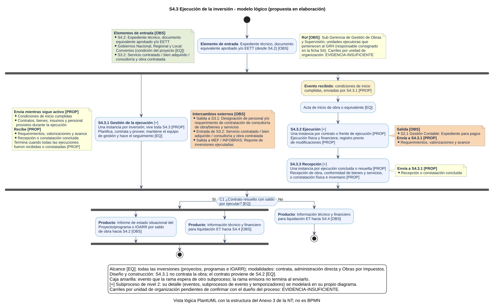

# S4.3 Ejecucion de la inversion - Ficha de producto y proceso

Sube a: [S4.3 Ejecucion de la inversion](00-S4-3-ejecucion-inversion.md)

<!-- Primer borrador (ELABORACION). Cada dato tiene su fuente y clase en S4-3-sustento.md. Los campos PENDIENTE requieren definicion del dueno del proceso. -->

## Nombre del proceso

S4.3 Ejecucion de la inversion

## Tipo de proceso

Apoyo

## Dueno del proceso

PENDIENTE. La ficha aprobada de S4 consigna como responsable de S4.3 a la Sub Gerencia de Gestion de Obras y Supervision y a las unidades ejecutoras que pertenecen al GRH; falta confirmar si corresponde al dueno del proceso.

## Objetivo del proceso

PENDIENTE de definicion por el dueno del proceso.

## Objetivo estrategico

PENDIENTE. La ficha aprobada de S4 se vincula a OEI.06 Garantizar una gestion institucional orientada al ciudadano y a AEI.06.10 Procesos administrativos eficientes en inversiones para Infraestructura en el departamento de Huanuco; falta confirmar si S4.3 se vincula al mismo objetivo.

## Proveedor, elementos de entrada, producto y receptor

| Proveedor de elemento de entrada | Elementos de entrada | Producto | Receptor del producto |
|---|---|---|---|
| S4.2 Elaboracion del expediente tecnico | Expediente tecnico, documento equivalente aprobado y/o EETT | Designacion de personal y/o requerimiento de contratacion de consultoria de obra/bienes y servicios | S3.1 Programacion de bienes y servicios |
| Gobiernos Nacional, Regional y Local | Convenios | Reporte de inversiones ejecutadas | MEF / INFOBRAS |
| S3.2 Contratacion de bienes y servicios | Servicio contratado / bien adquirido / consultoria y obra contratada | Expediente para pagos | S2.1 Gestion Contable |
| | | Informacion tecnico y financiero para liquidacion ET | S4.4 Liquidacion, transferencia y cierre de inversion |
| | | Informe de estado situacional del Proyecto/programa o IOARR por saldo de obra | S4.2 Elaboracion del expediente tecnico |

Las columnas de entradas y de productos se leen por separado: una misma fila no relaciona una entrada con un producto.

## Actividades del proceso

Procesos de nivel 2 propuestos: S4.3.1 Gestion de la ejecucion, transversal a toda S4.3, que entrega contratos y condiciones de inicio a S4.3.2 Ejecucion; y S4.3.3 Recepcion.

## Riesgos

No aplica: S4.3 no es un proceso de ultimo nivel.

## Registros

No aplica: S4.3 no es un proceso de ultimo nivel.

## Elaborado por, revisado por y aprobado por

| Elaborado por | Revisado por | Aprobado por |
|---|---|---|
| PENDIENTE | PENDIENTE | PENDIENTE |
