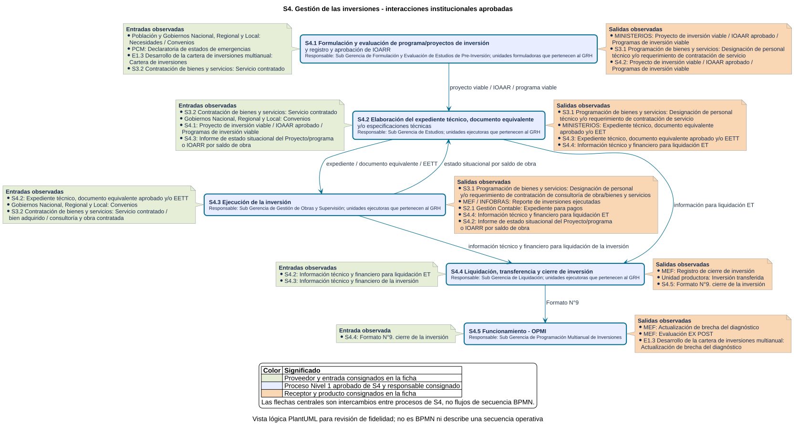

# S4 Gestion de las inversiones - Ficha de producto y proceso

Sube a: [S4 Gestion de las inversiones](00-S4-gestion-de-las-inversiones.md)

Transcripcion de la ficha institucional aprobada del proceso Nivel 0 S4 (formato institucional, version 3.0), ordenada segun los campos de la ficha de producto y proceso de la NT 002-2025-PCM-SGP. El contenido se conserva tal como figura en el original; su fuente, calidad, control de fidelidad y discrepancias se encuentran en el [sustento de S4](S4-sustento.md).

> [!important] Documento aprobado
> El equipo del proyecto confirmo el 2026-10-16 que la ficha S4 es oficial y aprobada. Este documento no se edita: cualquier variacion se plantea en un archivo `-propuesta`. La transcripcion queda pendiente de la comprobacion humana de fidelidad.

## Nombre del proceso

S4. Gestion de las inversiones

## Tipo de proceso

Apoyo

## Dueno del proceso

- Gerencia Regional de Infraestructura.
  - Sub Gerencia de Estudios.
  - Sub Gerencia de Gestion de Obras y Supervision.
  - Sub Gerencia de Liquidacion.
- Gerencia Regional de Planeamiento y Presupuesto y Acondicionamiento Territorial.
  - Sub Gerencia de Formulacion y Evaluacion de Estudios de Pre-Inversion.
  - Sub Gerencia de Programacion Multianual de Inversiones.
- Gerencia Regional de Recursos Naturales y Gestion Ambiental.
  - Sub Gerencia de Recursos Naturales.
  - Sub Gerencia de Gestion Ambiental.
- Gerencia Regional de Desarrollo Economico.
  - Sub Gerencia de la Inversion Privada Sostenible.
- Direccion Regional de Transportes y Comunicaciones.
- Direccion Regional de Vivienda, Construccion y Saneamiento.
- Direccion Regional de Salud.
- Direccion Regional de Agricultura.
- Direccion Regional de Energia y Minas.

## Objetivo del proceso

Determinar el uso adecuado de los recursos publicos destinados a la inversion para la efectiva prestacion de servicios y la provision de la infraestructura necesaria en el plazo previsto alineados al cierre de brechas.

## Objetivo estrategico

| Campo | Transcripcion observada |
|---|---|
| Objetivo estrategico | OEI. 06 Garantizar una gestion institucional orientada al ciudadano. |
| Accion estrategica | AEI.06.10 Procesos administrativos eficientes en inversiones para Infraestructura en el departamento de Huanuco. |

## Proveedor, elementos de entrada, producto y receptor

La ficha institucional organiza estos elementos por proceso Nivel 1. En las tablas, `Entrada` identifica al proveedor y el elemento de entrada; `Salida` identifica el producto y su receptor.

### Procesos Nivel 1 y responsables

| Codigo | Proceso | Responsable observado |
|---|---|---|
| S4.1 | Formulacion y evaluacion de programa/proyectos de inversion y registro y aprobacion de IOARR | Sub Gerencia de Formulacion y Evaluacion de Estudios de Pre-Inversion; unidades formuladoras que pertenecen al GRH |
| S4.2 | Elaboracion del expediente tecnico, documento equivalente y/o especificaciones tecnicas | Sub Gerencia de Estudios; unidades ejecutoras que pertenecen al GRH |
| S4.3 | Ejecucion de la inversion | Sub Gerencia de Gestion de Obras y Supervision; unidades ejecutoras que pertenecen al GRH |
| S4.4 | Liquidacion, transferencia y cierre de inversion | Sub Gerencia de Liquidacion; unidades ejecutoras que pertenecen al GRH |
| S4.5 | Funcionamiento - OPMI | Sub Gerencia de Programacion Multianual de Inversiones |

Las filas siguientes estructuran la tabla de las paginas impresas 120-121. Describen proveedores, entradas, productos y receptores; no agregan actividades ni una secuencia que la fuente no declare.

### S4.1 Formulacion y evaluacion

| Sentido | Contraparte | Elemento observado |
|---|---|---|
| Entrada | Poblacion y Gobiernos Nacional, Regional y Local | Necesidades / Convenios |
| Entrada | PCM | Declaratoria de estados de emergencias |
| Entrada | E1.3 Desarrollo de la cartera de inversiones multianual | Cartera de inversiones |
| Entrada | S3.2 Contratacion de bienes y servicios | Servicio contratado |
| Salida | MINISTERIOS | Proyecto de inversion viable / IOAAR aprobado / Programas de inversion viable |
| Salida | S3.1 Programacion de bienes y servicios | Designacion de personal tecnico y/o requerimiento de contratacion de servicio |
| Salida | S4.2 Elaboracion del expediente tecnico, documento equivalente y/o especificaciones tecnicas | Proyecto de inversion viable / IOAAR aprobado / Programas de inversion viable |

### S4.2 Elaboracion del expediente tecnico

| Sentido | Contraparte | Elemento observado |
|---|---|---|
| Entrada | S3.2 Contratacion de bienes y servicios | Servicio contratado |
| Entrada | Gobiernos Nacional, Regional y Local | Convenios |
| Entrada | S4.1 Formulacion y evaluacion | Proyecto de inversion viable / IOAAR aprobado / Programas de inversion viable |
| Entrada | S4.3 Ejecucion de la inversion | Informe de estado situacional del Proyecto/programa o IOARR por saldo de obra |
| Salida | S3.1 Programacion de bienes y servicios | Designacion de personal tecnico y/o requerimiento de contratacion de servicio |
| Salida | MINISTERIOS | Expediente tecnico, documento equivalente aprobado y/o EET |
| Salida | S4.3 Ejecucion de la inversion | Expediente tecnico, documento equivalente aprobado y/o EETT |
| Salida | S4.4 Liquidacion, transferencia y cierre de la inversion | Informacion tecnico y financiero para liquidacion ET |

### S4.3 Ejecucion de la inversion

| Sentido | Contraparte | Elemento observado |
|---|---|---|
| Entrada | S4.2 Elaboracion del expediente tecnico | Expediente tecnico, documento equivalente aprobado y/o EETT |
| Entrada | Gobiernos Nacional, Regional y Local | Convenios |
| Entrada | S3.2 Contratacion de bienes y servicios | Servicio contratado / bien adquirido / consultoria y obra contratada |
| Salida | S3.1 Programacion de bienes y servicios | Designacion de personal y/o requerimiento de contratacion de consultoria de obra/bienes y servicios |
| Salida | MEF / INFOBRAS | Reporte de inversiones ejecutadas |
| Salida | S2.1 Gestion Contable | Expediente para pagos |
| Salida | S4.4 Liquidacion, transferencia y cierre de inversion | Informacion tecnico y financiero para liquidacion ET |
| Salida | S4.2 Elaboracion del expediente tecnico | Informe de estado situacional del Proyecto/programa o IOARR por saldo de obra |

### S4.4 Liquidacion, transferencia y cierre

| Sentido | Contraparte | Elemento observado |
|---|---|---|
| Entrada | S4.2 Elaboracion del expediente tecnico | Informacion tecnico y financiero para liquidacion ET |
| Entrada | S4.3 Ejecucion de la inversion | Informacion tecnico y financiero de la inversion |
| Salida | MEF | Registro de cierre de inversion |
| Salida | Unidad productora | Inversion transferida |
| Salida | S4.5 Funcionamiento - OPMI | Formato N°9. cierre de la inversion |

### S4.5 Funcionamiento - OPMI

| Sentido | Contraparte | Elemento observado |
|---|---|---|
| Entrada | S4.4 Liquidacion, transferencia y cierre de inversion | Formato N°9. cierre de la inversion |
| Salida | MEF | Actualizacion de brecha del diagnostico |
| Salida | MEF | Evaluacion EX POST |
| Salida | E1.3 Desarrollo de la cartera de inversiones multianual | Actualizacion de brecha del diagnostico |

## Actividades del proceso

La vista siguiente fue generada localmente desde PlantUML. Presenta los cinco procesos Nivel 1, los responsables consignados y las entradas y salidas de las paginas impresas 120-123. Las flechas centrales representan intercambios entre procesos de S4, no orden temporal ni flujo de secuencia BPMN.

La fuente se regenera y comprueba con el [gestor local de modelos](../../05-herramientas/gestor-modelos/00-gestor-modelos.md). El SVG es derivado y no debe editarse manualmente.

## Indicadores del proceso

Las fichas de indicador S4-IND-1, S4-IND-2 y S4-IND-3 se registran en [fichas de indicador de S4](S4-fichas-indicador.md).

## Datos propios del formato institucional

| Campo | Transcripcion observada |
|---|---|
| Version | 3.0 |

## Elaborado por, revisado por y aprobado por

| Elaborado por | Revisado por | Aprobado por |
|---|---|---|
| Sin nombre visible en el original | Sin nombre visible en el original | Sin nombre visible en el original |

La situacion se registra como `EVIDENCIA-INSUFICIENTE` en el [sustento de S4](S4-sustento.md).

## Relaciones

- [Portada de S4](00-S4-gestion-de-las-inversiones.md)
- [Fichas de indicador de S4](S4-fichas-indicador.md)
- [Sustento de S4](S4-sustento.md)
- [Inventario de productos y procesos](../mapa-de-procesos-institucional/inventario-productos-procesos.md)
- [Mapa de procesos Nivel 0](../mapa-de-procesos-institucional/mapa-procesos-nivel-0.md)
