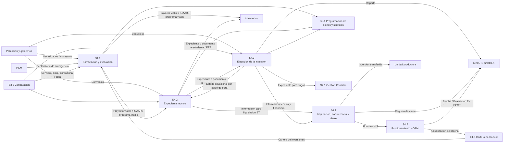

# S4 Gestion de las inversiones - Sustento

Sube a: [S4 Gestion de las inversiones](00-S4-gestion-de-las-inversiones.md)

Registra la fuente, la calidad, la autoridad, el control de fidelidad, las discrepancias y el historial de revision de los documentos de S4. No se exporta a PDF.

## Identificacion documental

| Campo | Valor observado |
|---|---|
| Documento | Ficha del proceso Nivel 0 S4 y fichas de indicadores |
| Codigo del mapa | SGMD-MP-003 |
| Version | 3.0 |
| Ubicacion precisa | Paginas PDF 1-7; paginas impresas 120-126 |
| Fecha de consulta | 2026-10-15 |
| Vigencia | Aprobado y adoptado como linea base vigente del proyecto por confirmacion del equipo; acto y fecha formal no visibles en el PDF |
| SHA-256 | `F86C31E6A6BDFFBDBF7D5186BFD21E1FD58522BC546E0127296BD8C461931F83` |
| Original inmutable | [s4-gestion-inversion.pdf](../../01-referencias/01-institucionales-grh/originales/s4-gestion-inversion.pdf) |

### Calidad tecnica de la fuente

- Las siete paginas poseen una capa de texto utilizable; no se aplico OCR.
- Las siete paginas fueron renderizadas e inspeccionadas visualmente para contrastar estructura, tablas y diagrama.
- La pagina impresa 123 contiene el diagrama principalmente como grafico; sus relaciones se contrastaron con las tablas de las paginas impresas 120-121.
- La legibilidad es suficiente para consulta y transcripcion. Las discrepancias documentales enumeradas mas adelante forman parte del control de fidelidad y no se corrigen sin decision institucional.

## Autoridad y uso

- El PDF institucional es la fuente primaria aprobada.
- La [ficha de producto y proceso](S4-ficha-producto-proceso.md) y las [fichas de indicador](S4-fichas-indicador.md) son la traduccion estructurada para consulta, trazabilidad y posterior modelamiento.
- El archivo [PlantUML logico](S4-diagrama-proceso-logico.puml) es la fuente editable de la vista visual y el [SVG](S4-diagrama-proceso-logico.svg) es su derivado generado.
- La [configuracion del modelo](S4-diagrama-proceso-modelo.yaml) declara fuente, alcance, artefactos y estado de revision.
- Ninguna discrepancia del original se armoniza automaticamente. Una correccion requiere evidencia o decision institucional registrada.

## Control de fidelidad de la traduccion

| Control | Resultado tecnico | Estado humano |
|---|---|---|
| Procesos Nivel 1 | 5 de 5 representados: S4.1 a S4.5 | Pendiente de conformidad |
| Filas de interaccion | 32 de 32 transcritas en las tablas y notas visuales | Pendiente de conformidad |
| Interacciones dirigidas unicas | 26 de 26 representadas al descontar las seis relaciones internas repetidas como entrada y salida | Pendiente de conformidad |
| Responsables | Los responsables de los cinco procesos se incorporaron desde las paginas impresas 120-121 | Pendiente de conformidad |
| Indicadores | 3 de 3 fichas transcritas desde las paginas impresas 124-126 | Pendiente de conformidad |
| Discrepancias del original | Se conservan y enumeran sin normalizacion silenciosa | Pendiente de decision cuando corresponda |
| Derivado PlantUML | Generacion local reproducible y comprobacion byte a byte operativas | Superado tecnicamente |

> [!warning] Revision requerida
> La comprobacion tecnica demuestra completitud estructural, no fidelidad institucional por si sola. El equipo debe contrastar esta nota y el SVG con el PDF aprobado. Hasta esa conformidad, la configuracion mantiene `PENDIENTE-REVISION-HUMANA`.

### Vista Mermaid provisional

Esta vista anterior se conserva temporalmente como control comparativo hasta que el equipo acepte la traduccion PlantUML. Es un indice visual Mermaid, no un modelo BPMN ni una declaracion de orden temporal.

## Discrepancias y controles pendientes

| Hallazgo observado | Tratamiento |
|---|---|
| El encabezado de la pagina impresa 120 dice `S4. Gestion de la inversion`, mientras el campo nombre dice `S4. Gestion de las inversiones`. | Se usa el nombre del campo estructurado y se conserva la discrepancia para revision de fidelidad. |
| El proceso S4 figura como tipo `Apoyo`, pero las tres fichas califican sus indicadores como `Misional`. | No se armoniza sin decision institucional. |
| La denominacion del proceso usa `IOARR`, mientras varios productos dicen `IOAAR`. | Se conservan ambos textos tal como aparecen; requiere correccion o confirmacion humana. |
| La relacion S4.3 a S4.4 usa `Informacion tecnico y financiero para liquidacion ET` como salida de S4.3, `Informacion tecnico y financiero de la inversion` como entrada de S4.4 y una tercera formulacion en el diagrama de la pagina impresa 123. | La vista PlantUML conserva las dos formulaciones de la tabla en sus notas y usa en la flecha central la formulacion del diagrama; no se unifican sin decision institucional. |
| El diagrama usa algunos prefijos `PA` para procesos que la ficha identifica como `S`. | La traduccion estructurada usa los codigos de la ficha y conserva el hallazgo; no se modifica el original. |
| La seccion de indicadores de la pagina impresa 122 enumera solo S4-IND-1, pero las paginas siguientes contienen S4-IND-1, S4-IND-2 y S4-IND-3. | Se registran los tres y se mantiene el hallazgo. |
| Los campos Elaborado por, Revisado por y Aprobado por aparecen sin nombres visibles. | EVIDENCIA-INSUFICIENTE para atribuir autoria, revision o aprobacion. |
| La fuente no muestra en estas paginas el acto aprobatorio ni una fecha de vigencia. | La aprobacion fue confirmada por el equipo; permanece EVIDENCIA-INSUFICIENTE para identificar el acto y su fecha. |

## Limites para el modelamiento

- Esta nota representa la arquitectura institucional aprobada de S4; no es el AS-IS operativo detallado y validado con especialistas.
- No se han inferido actividades internas de S4.3, responsables adicionales, compuertas, eventos, plazos, reglas contractuales ni requisitos BIM.
- La primera descomposicion de S4.3 se registrara en el sustento de S4.3, se contrastara con evidencia y normas y se reflejara en su ficha en elaboracion antes de someterla al circuito de revision.
- Cuando se modele el flujo operativo, el BPMN 2.0 XML sera la fuente maestra; cualquier SVG, PDF, Mermaid o Canvas sera una vista derivada. La vista PlantUML de esta nota sigue siendo una traduccion logica de la ficha aprobada, no un BPMN formal.

## Historial de revision

| Documento | Nivel | Fecha | Resultado | Rol o unidad | Evidencia |
|---|---|---|---|---|---|
| Ficha de producto y proceso y fichas de indicador de S4 | APROBACION | 2026-10-16 | Adoptada como linea base institucional | Equipo del proyecto | Confirmacion registrada en DEC-016; acto formal `EVIDENCIA-INSUFICIENTE` |
| Traduccion Markdown y PlantUML de S4 | REVISION-EQUIPO | Pendiente | Pendiente de conformidad de fidelidad | Equipo del proyecto | Pendiente |

## Relaciones

- [Portada de S4](00-S4-gestion-de-las-inversiones.md)
- [Ficha de producto y proceso de S4](S4-ficha-producto-proceso.md)
- [Fichas de indicador de S4](S4-fichas-indicador.md)
- [Registro de decisiones](../../00-gobernanza/registro-decisiones.md)
- [Metodologia de modelamiento](../../00-gobernanza/metodologia-modelamiento.md)
