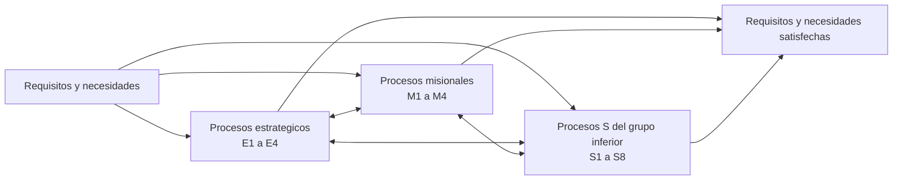

# Mapa de procesos Nivel 0

Sube a: [Mapa de procesos institucional](00-mapa-de-procesos-institucional.md)

Esta nota transcribe el mapa institucional Nivel 0 aprobado para que pueda consultarse sin abrir el PDF. Registra cuatro procesos estrategicos, cuatro misionales y ocho procesos codificados `S`; la ficha aprobada de S4 clasifica S4 Gestion de las inversiones como proceso de apoyo. Sus codigos, denominaciones y relacion global son regla de arquitectura para este proyecto mientras no se reciba una version institucional posterior. La discrepancia de rotulo del grupo `S` se conserva en los limites de uso.

> [!important] Linea base institucional aprobada
> El equipo del proyecto confirmo el 2026-10-16 que este mapa es el definitivo y aprobado. El PDF original conserva la maxima autoridad; esta representacion controlada queda pendiente de la comprobacion final de fidelidad. El acto y la fecha formal de aprobacion no son visibles en el archivo recibido.

## Identificacion de la fuente

| Campo | Valor observado |
|---|---|
| Documento | Mapa de Procesos Nivel 0 |
| Version | 3.0 |
| Unidad indicada | Gerencia Regional de Planeamiento, Presupuesto y Acondicionamiento Territorial; Sub Gerencia de Modernizacion y Transformacion Digital |
| Ubicacion precisa | Pagina PDF 1 de 1 |
| Fecha de consulta | 2026-10-15 |
| Vigencia | Aprobado y adoptado como linea base vigente del proyecto por confirmacion del equipo; acto y fecha formal no visibles en el PDF |
| SHA-256 | `4918B636122C9AF3825B159EF89B75C26FE6189FA908EDBB162ECAE046FF374F` |
| Original inmutable | [mapa-procesos-grh-nivel-0.pdf](../../01-referencias/01-institucionales-grh/originales/mapa-procesos-grh-nivel-0.pdf) |

## Entradas y resultado global

| Posicion | Texto observado |
|---|---|
| Entrada | Requisitos y necesidades de las personas que reciben los bienes y servicios de la entidad |
| Resultado | Requisitos y necesidades de las personas que reciben los bienes y servicios de las entidades satisfechas |

## Procesos estrategicos

| Codigo | Denominacion observada |
|---|---|
| E1 | Direccionamiento estrategico |
| E2 | Gestion del desarrollo y modernizacion institucional |
| E3 | Gestion de alianzas y posicionamiento institucional |
| E4 | Gestion del sistema de control interno y la integridad institucional |

## Procesos misionales

| Codigo | Denominacion observada |
|---|---|
| M1 | Gestion del desarrollo social |
| M2 | Gestion de la competitividad economica y productiva |
| M3 | Integracion territorial regional |
| M4 | Gestion ambiental y de riesgo de desastres |

## Procesos S del grupo inferior

El mapa rotula visualmente este grupo como `PROCESOS MISIONALES`, aunque utiliza codigos `S1` a `S8` y la ficha aprobada de S4 clasifica S4 como `Apoyo`. La tabla conserva los codigos y denominaciones; no generaliza la clasificacion de los ocho procesos sin una aclaracion institucional.

| Codigo | Denominacion observada |
|---|---|
| S1 | Gestion del recurso humano |
| S2 | Gestion contable y financiera |
| S3 | Gestion de bienes y servicios |
| S4 | [Gestion de las inversiones](../s4-gestion-de-las-inversiones/00-s4-gestion-de-las-inversiones.md) |
| S5 | Gestion de transformacion digital |
| S6 | Gestion de asuntos legales |
| S7 | Gestion de archivo |
| S8 | Gestion de transparencia y atencion al ciudadano |

## Vista estructural derivada

La vista siguiente resume la estructura y las interacciones graficas generales observadas. Es una vista Mermaid para navegacion; no es BPMN y no establece secuencia operativa.

## Calidad y limites de uso

- Evidencia observada: codigos, denominaciones, agrupacion y version se leen en la unica pagina del original.
- Estado institucional: aprobado y definitivo segun confirmacion del equipo del proyecto del 2026-10-16.
- EVIDENCIA-INSUFICIENTE: la pagina no permite identificar el acto aprobatorio ni su fecha; esta carencia documental no modifica la confirmacion institucional recibida, pero debe completarse cuando se ubique el control correspondiente.
- Evidencia visual: se observan tres sellos institucionales y trazos de firma en la parte inferior; no se atribuyen nombres ni cargos porque no son legibles con certeza.
- Discrepancia del original: el bloque inferior `S1` a `S8` esta rotulado `PROCESOS MISIONALES`, mientras la ficha S4 identifica S4 como tipo `Apoyo`. No se corrige el PDF ni se extiende automaticamente esa clasificacion a los demas procesos `S`.
- La orientacion visual del PDF dificulta la lectura directa, pero su capa de texto es utilizable; no fue necesario aplicar OCR.
- Las flechas del mapa expresan interaccion general entre agrupaciones. No deben interpretarse como flujo BPMN, dependencia contractual ni orden temporal.

## Relaciones

- [Inventario de productos y procesos](inventario-productos-procesos.md)
- [S4 Gestion de las inversiones](../s4-gestion-de-las-inversiones/00-s4-gestion-de-las-inversiones.md)
- [Mapa de procesos institucional](00-mapa-de-procesos-institucional.md)
