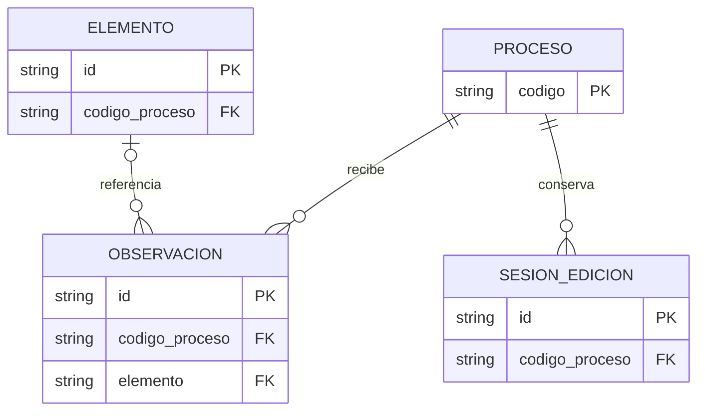

# Modelo de datos operativo

El repositorio institucional conserva los documentos maestros; la aplicación registra observaciones y sesiones de edición locales por proceso. No existe aún una base de datos transaccional ni otro modelo maestro.

Sube a: [Documentación de la aplicación](00-documentacion-aplicacion.md).

## Diagrama

El diagrama expresa asociaciones lógicas: proceso y elemento viven en el repositorio institucional; no existen tablas SQL ni claves foráneas físicas. `elemento` puede estar vacío para una observación del diagrama completo.

## Diccionario

La preparación PDF conserva `01-referencias/09-derivados-texto/cache/preparacion-pdf.json`. Cada entrada usa la ruta relativa como llave y registra ID documental, SHA-256 del original, tamaño, procedencia del registro, URL, diagnóstico por página, plan nativo/OCR, prioridad y estado de extracción. El texto derivado se guarda como `<id>/<sha256-corto>-<hash-ruta>.md`, con metadatos de método, fecha, herramienta y marcadores de página física. Cada PDF tiene también su carpeta `<sha256-corto>-<hash-ruta>.ocr/` para las páginas intermedias. El hash de ruta evita que dos PDF idénticos con el mismo ID compartan un encabezado o páginas OCR de procedencia diferente. Los trabajos OCR conservan ID de trabajo, páginas y avisos de baja confianza; el cotejo local se genera bajo `cache/cotejos/`. Todos estos archivos son caché regenerable y no constituyen citas normativas validadas.

| Entidad | Identidad y ubicación | Relación |
|---|---|---|
| Proceso | Código NT y carpeta única bajo `02-procesos/` | Puede tener tabla, sustento, BPMN y observaciones |
| Elemento | ID BPMN dentro del proceso | Puede recibir una observación |
| Observación | UUID en `<codigo>-observaciones.json` | Pertenece a un proceso y opcionalmente a un elemento |
| Sesión de edición | UUID en `.mesa-sesiones/<codigo>/<id>/manifest.json` | Pertenece a un proceso; solo una sesión abierta por código |

El JSON de observaciones conserva `modelo`, `observaciones` y, por registro, `id`, `elemento`, `referencia`, `texto`, `autor`, `tipo`, `estado` y fechas. `revision` es un hash calculado del contenido, no un campo persistido. Las escrituras usan un bloqueo local y reemplazo atómico; eso protege procesos locales que comparten el mismo sistema de archivos, sin resolver todavía concurrencia distribuida. La base de datos para varios autores y el bloqueo de un solo editor pertenecen a E8 del [plan](../plan-mesa-modelamiento.md).

Cada observación nueva incluye `respuestas` e `historial`. Una respuesta guarda ID, texto, autor declarado y fecha; el historial registra creación, respuesta o cambio de estado. Los archivos anteriores sin estos campos siguen legibles y reciben las colecciones al primer cambio. No hay borrado físico ni atribución de identidad verificada.

Los anclajes de lectura residen en `<codigo>-fuentes-visor.json` del proceso y se proyectan como `fuentes_visor` en la API. La clave es el ID de tabla; cada entrada contiene ruta registrada, página física opcional para PDF, fragmento, título, ubicación, consulta y vigencia. Un enlace PDF puede incluir `sha256` y `rectangulos`: cajas normalizadas `[x0, y0, x1, y1]` respecto de la página renderizada, con origen arriba a la izquierda. Se capturan y cotejan al crear el enlace. La API solo entrega esas cajas si el hash actual coincide; en caso contrario devuelve `estado_ancla: HASH_DISTINTO` sin rectángulos. Las referencias anteriores sin coordenadas siguen abriendo la página y muestran `SIN_COORDENADAS`. El visor no busca el fragmento al abrir el PDF. Son metadatos de localización, no un almacén nuevo de normas ni una declaración de validación.

Cada sesión conserva `origen/` y `copia/`. El manifiesto registra hash SHA-256 del origen, revisión numérica, estado `ABIERTA`, `INTEGRADA` o `CERRADA`, y preparación con diff y resultado del generador. La sesión no sustituye la tabla ni el BPMN vigentes: solo una integración válida actualiza el árbol de trabajo. El almacén persistente se excluye de Git por contener cambios no confirmados; su recuperación se explica en [sesiones de edición](sesiones-edicion.md).
