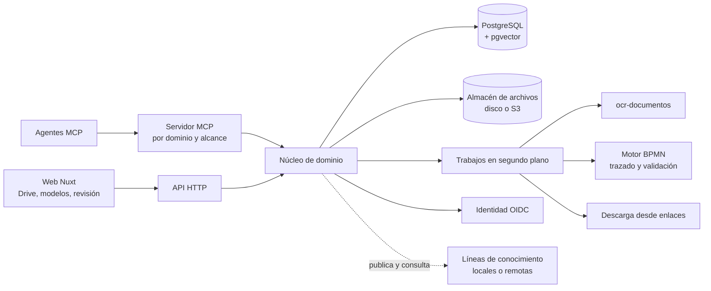
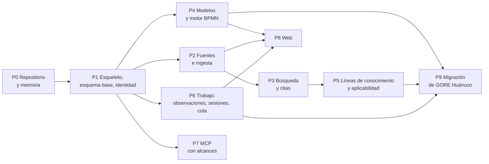

# Plan A: construcción del sistema nuevo de modelamiento

Sube a: [Documentación de la aplicación](00-documentacion-aplicacion.md).

Estado: **copia de origen, no se actualiza**. La versión vigente está en el repositorio nuevo:
`~/mgpp/docs/plan-implementacion.md`. Se conserva aquí como respaldo del plan del 2026-11-26.

Decisiones ya tomadas por el usuario (2026-11-26):

- Nombre y ubicación: repositorio `mgpp` en `~/mgpp`.
- PostgreSQL desde el inicio.
- Varias instituciones desde el diseño: hay una tabla de instituciones desde el primer esquema.
- Repositorio propio desde el inicio; la herramienta actual sigue operando hasta la migración.
- El trabajo actual continúa en paralelo, con [versiones livianas](plan-versiones-validacion.md) para la
  validación con especialistas.
- La documentación y la estructura del repositorio son fundamentales; se usan las skills propias del usuario,
  en particular `gestionar-memoria-viva-proyecto` (estándar 1.9.0, como en modelador-bim).
- El plan debe poder ejecutarlo más de un agente en paralelo.

## 1. Visión

Una herramienta, manejable por cualquier agente mediante MCP, para **transformar fuentes en conocimiento y
conocimiento en modelos de procesos**, con trazabilidad de cada afirmación a su fuente, para cualquier
institución. Separa el **producto** (código, motor, reglas fijas) del **contenido** (fuentes, conocimiento,
modelos y trabajo de cada institución).

### Reglas fijas del producto

Valen para toda institución y ningún perfil puede desactivarlas:

1. La IA propone; nunca valida, aprueba ni atribuye conformidad a una persona.
2. Toda afirmación distingue evidencia observada, exigencia normativa, inferencia y propuesta, y apunta a su
   fuente (documento, página, fragmento).
3. Los originales no se modifican; todo derivado (OCR, Markdown, fragmentos, modelos) conserva su origen.
4. Las versiones y líneas base son inmutables y verificables por hash.
5. Un vacío de evidencia se registra como tal; no se completa.

Todo lo demás (norma técnica aplicable, plantillas de fichas, paleta BPMN, estados de revisión, vocabulario,
convenciones de carriles) es **perfil de lineamiento** configurable.

## 2. Conceptos del dominio

| Concepto | Definición |
|---|---|
| Institución | Entidad que usa la herramienta (p. ej., GORE Huánuco). Tiene un perfil: nivel de gobierno, territorio, sector, tipo de entidad |
| Ámbito de aplicación | Nivel (nacional, regional, local), territorio, sector, tipo de entidad y vigencia a los que aplica una norma o regla |
| Línea de conocimiento | Cuerpo de conocimiento documentado y versionado sobre un tema (p. ej., «Ejecución de obras públicas – Ley 32069»): fuentes, fragmentos, reglas, glosario, decisiones e instrumentos. **Trasciende a la institución** |
| Suscripción | Una institución declara qué líneas usa y en qué versión; la aplicabilidad filtra lo que le corresponde |
| Lineamiento | Perfil de modelamiento de una institución (p. ej., NT 002-2025-PCM-SGP: fichas, anexos, estados) |
| Proyecto de modelamiento | Trabajo de una institución con un lineamiento y un conjunto de líneas suscritas |
| Proceso y modelo | Proceso del mapa institucional y su modelo (carriles, elementos, flujos), con clase y fuente por elemento |
| Versión y línea base | Estado inmutable de un modelo; la línea base es una versión aprobada por personas y exportable |
| Observación, sesión, trabajo | Revisión, edición con bloqueo y cola de agentes (como hoy) |
| Agente | Cliente MCP con identidad, institución y alcances propios |

### Líneas de conocimiento y aplicabilidad

Es la pieza que hace reutilizable el sistema entre instituciones, y la que requiere más diseño:

- **Autoría** en el sistema (base de datos), con cada elemento etiquetado por ámbito de aplicación y vigencia.
- **Publicación** como paquete versionado (manifiesto, Markdown, fragmentos e índice), exportable a un
  repositorio Git propio de la línea. Otras instancias pueden importarlo o consultarlo en remoto.
- **Consulta federada**: el MCP de conocimiento de una instancia puede apuntar a líneas locales o a un MCP de
  conocimiento remoto. La respuesta indica siempre de qué línea, versión y fuente proviene.
- **Resolución de aplicabilidad**: dado el perfil de la institución, se filtran las reglas que le aplican
  (nacional siempre; regional solo si es del territorio; local solo de su jurisdicción; sector y tipo de
  entidad; vigencia a la fecha del caso). Los conflictos se ordenan por jerarquía normativa y especialidad, y se
  muestran en lugar de resolverse en silencio.
- El repositorio `normatividad` (portal normativo del GORE) es candidato a primera fuente regional de una línea.

## 3. Arquitectura destino



| Componente | Responsabilidad | Reutiliza |
|---|---|---|
| Núcleo de dominio | Servicios de los cinco dominios; único lugar con reglas | Servicios de `mesa_modelamiento` (patrón CLI/API/MCP sobre un núcleo) |
| API HTTP | Web y automatizaciones | FastAPI actual |
| Servidor MCP | Interfaz principal de agentes; herramientas por dominio; recursos para páginas PDF y fragmentos | MCP actual (53 herramientas) como inventario |
| Trabajos en segundo plano | Ingesta, OCR, segmentación, indexación, generación de BPMN y paquetes | Cola actual, pasada a la base |
| Motor BPMN | Modelo → BPMN con trazado, validación D1-D5, exportaciones | `tabla_a_bpmn.py`, validadores, `renderizar_bpmn.py` como paquete |
| Web | Drive de fuentes, visor PDF con citas, modelos, observaciones, historial | Componentes Nuxt actuales |
| Identidad | Personas y agentes, institución y alcances | Zitadel y `auth-service` existentes, a decidir |

### Cinco dominios de datos

Todas las tablas llevan `institucion_id` salvo las de líneas de conocimiento, que tienen su propio dueño y
visibilidad.

| Dominio | Entidades principales |
|---|---|
| Fuentes | carpeta, archivo (hash, tipo, tamaño, almacén), origen (carga o enlace), derivado (texto, OCR, Markdown con anclas por página), fragmento, índice (texto completo y vector) |
| Conocimiento | línea, versión de línea, elemento de conocimiento (regla, definición, decisión, instrumento), ámbito de aplicación, cita a fragmento, suscripción, contexto guardado (paquete por proceso o tarea) |
| Modelos | proceso (árbol), modelo, carril, elemento, flujo, versión (inmutable, contenido por hash), operación, cambio por elemento, línea base, producto generado |
| Trabajo | observación (etapas actuales), sesión con bloqueo, trabajo de agente, evento de auditoría |
| Organización | institución, perfil (nivel, territorio, sector), lineamiento, proyecto, persona, agente, alcance |

El modelo de procesos se guarda como **datos estructurados** (elementos y flujos), no como texto. La tabla
Markdown actual pasa a ser formato de **importación y exportación**, útil para migrar y para revisar.

## 4. Decisiones técnicas pendientes

Cada una se registra como ADR en el repositorio nuevo antes del paquete que la necesita. La recomendación es un
punto de partida, no una decisión tomada.

| N.º | Decisión | Opciones | Recomendación | Se necesita en |
|---|---|---|---|---|
| D1 | Nombre del repositorio y del producto | — | **Decidido**: `mgpp`, en `~/mgpp` | P0 |
| D2 | Lenguaje y marco del backend | Python/FastAPI; PHP/Laravel (como `normatividad`) | Python/FastAPI: reutiliza núcleo, motor BPMN, MCP y OCR | P0 |
| D3 | Acceso a datos y migraciones | SQLAlchemy 2 + Alembic; SQL directo | SQLAlchemy 2 + Alembic | P1 |
| D4 | Separación entre instituciones | Columna `institucion_id` con RLS; esquema por institución; base por institución | Columna con RLS de PostgreSQL | P1 |
| D5 | Almacén de archivos | Disco local; MinIO; S3 externo | Interfaz única; disco al inicio, MinIO cuando haya más de un nodo | P2 |
| D6 | Búsqueda | Texto completo de PostgreSQL; pgvector; motor externo | Texto completo + pgvector en la misma base | P3 |
| D7 | Modelo de embeddings | Local; proveedor externo | Local por privacidad y costo, si la calidad alcanza; medir antes | P3 |
| D8 | Identidad | Zitadel actual vía `auth-service`; Zitadel directo; otro | Zitadel (OIDC) directo para personas; tokens por agente emitidos por el sistema | P1 |
| D9 | MCP | Un servidor con alcances; uno por dominio | Uno con alcances por token y herramientas agrupadas por dominio; HTTP | P1 |
| D10 | Representación del modelo | Grafo relacional (elementos y flujos); documento JSON por versión; ambos | Relacional para la versión vigente y edición; JSON por versión inmutable | P4 |
| D11 | Edición | Operaciones por elemento; texto completo | Operaciones por elemento validadas al instante; importación de tabla para cargas masivas | P4 |
| D12 | Motor BPMN | Extraer `tabla_a_bpmn.py` como paquete; reescribir | Extraer como paquete con entrada de modelo estructurado y pruebas de regresión con los 16 modelos actuales | P4 |
| D13 | Publicación de líneas | Paquete exportado a repositorio Git; solo API remota; ambos | Ambos: paquete versionado en Git y consulta por MCP remoto | P5 |
| D14 | Formato del paquete de línea | Markdown con metadatos + manifiesto JSON; JSONL | Markdown + manifiesto con hashes, compatible con Obsidian como vista | P5 |
| D15 | Frontend | Nuxt (como hoy); otro | Nuxt 4 + bpmn-js + visor PDF actual | P2 |
| D16 | Despliegue | Docker Compose; Kubernetes (como `normatividad`) | Compose al inicio; manifiestos de Kubernetes cuando haya más de una institución en producción | P0 |
| D17 | Trabajos en segundo plano | Cola en PostgreSQL; Redis/Celery | Cola en PostgreSQL (menos piezas) | P2 |
| D18 | Licencia y visibilidad del repositorio | Privado; abierto | Privado hasta estabilizar; decidir antes de publicar líneas | P0 |

## 5. Repositorio y documentación

Estructura inicial, con el estándar de memoria viva 1.9.0 desde el primer commit:

```text
mgpp/
├── AGENTS.md                      protocolo operativo (memoria viva) y reglas fijas del producto
├── CLAUDE.md                      → AGENTS.md
├── README.md
├── docs/
│   ├── guia_IA.md                 índice para agentes
│   ├── arquitectura.md  api.md  cli.md  mcp.md  modelo-datos.md  entorno.md
│   ├── convenciones.md  procedimientos.md  frontend.md  glosario.md
│   ├── plan-implementacion.md     este plan, con estado por paquete
│   ├── adr/                       ADR-0001… (decisiones D1-D18 y siguientes)
│   └── living-memory/             referencias locales del estándar
├── .github/instructions/          backend, frontend, infraestructura, motor
├── contracts/                     openapi.json, esquemas MCP, esquema de paquete de línea
├── backend/
│   ├── nucleo/<dominio>/          un módulo por dominio con su context.md
│   ├── api/  mcp/  trabajos/
│   └── migraciones/
├── motor-bpmn/                    paquete del motor con pruebas de regresión
├── frontend/
├── infraestructura/               compose, imágenes, respaldo
└── tests/
```

- Cada módulo de dominio tiene su `context.md` (negocio, actores, estados, reglas) y una instrucción de capa.
- Toda decisión que cambie alcance, contrato o convención es un ADR.
- `plan-implementacion.md` lleva el estado de cada paquete (pendiente, en curso, en revisión, hecho), su
  responsable y su rama; es la pizarra de coordinación entre agentes.

## 6. Paquetes de trabajo

Estrategia: **contratos primero**. P0 y P1 los ejecuta un solo agente porque fijan las bases; desde P2 los
paquetes corren en paralelo, cada uno dueño de sus directorios, comunicándose solo por contratos.



| Paquete | Objetivo | Entregables | Posee | Aceptación |
|---|---|---|---|---|
| **P0 Repositorio y memoria** | Base documental | Repositorio en `~/mgpp`, `AGENTS.md`, `docs/` completos con el estándar 1.9.0, ADR de D1, D2, D16 y D18, este plan trasladado | Todo (único agente) | Validador de memoria sin errores; usuario aprueba estructura |
| **P1 Esqueleto y bases** | Núcleo ejecutable | Compose con PostgreSQL, API y MCP vacíos; esquema de organización (institución, perfil, persona, agente, alcance); identidad OIDC y tokens de agente; RLS; ADR D3, D4, D8, D9 | `backend/` base, `infraestructura/`, `contracts/` | Prueba: dos instituciones no ven datos ajenos; un agente sin alcance recibe 403 |
| **P2 Fuentes e ingesta** | Drive de fuentes | Carpetas, carga, descarga desde enlace, hash y deduplicación, derivados (texto, OCR vía `ocr-documentos`, Markdown con anclas por página), almacén de archivos; ADR D5, D17 | `nucleo/fuentes`, `trabajos/ingesta` | Un PDF escaneado y uno con texto quedan con Markdown anclado por página y sin duplicados |
| **P3 Búsqueda y citas** | Consulta con evidencia | Fragmentos, índice de texto y vectorial, `buscar_fuentes`, `contexto_fragmento`, `anclar_cita`, recurso MCP de página PDF; ADR D6, D7 | `nucleo/fuentes/busqueda` | Paridad con las herramientas actuales sobre un corpus de prueba |
| **P4 Modelos y motor** | Modelos como datos | Esquema de modelo, versiones inmutables, operaciones por elemento, cambio por elemento, líneas base; motor BPMN extraído; importador y exportador de tabla; ADR D10, D11, D12 | `nucleo/modelos`, `motor-bpmn/` | Los 16 modelos actuales se importan y regeneran BPMN equivalente (regresión); cada operación inválida se rechaza con mensaje accionable |
| **P5 Líneas de conocimiento** | Conocimiento reutilizable | Elementos de conocimiento con ámbito y vigencia, versiones de línea, suscripciones, resolución de aplicabilidad, publicación como paquete Git, consulta remota; ADR D13, D14 | `nucleo/conocimiento` | Una regla regional no aparece para una institución de otro territorio; un paquete publicado se consulta desde otra instancia |
| **P6 Trabajo** | Revisión y coordinación | Observaciones con etapas, sesiones con bloqueo (`DEC-069`), cola de agentes, auditoría | `nucleo/trabajo` | Paridad con el flujo actual de análisis, definición y aplicación |
| **P7 MCP** | Interfaz de agentes | Herramientas por dominio con alcances, recursos y prompts; guía de uso para agentes | `backend/mcp/` | Un agente con alcance de lectura no puede editar; inventario de herramientas documentado |
| **P8 Web** | Interfaz de personas | Drive, visor PDF con citas, árbol de procesos, editor por elemento, observaciones, historial con diagrama coloreado; ADR D15 | `frontend/` | Recorridos principales verificados en navegador |
| **P9 Migración** | Traer el trabajo actual | Importación de fuentes, conocimiento, modelos, observaciones y su historial desde `modelado-procesos`; verificación por hashes; corte | `herramientas/migracion/` | Todo proceso migrado regenera su BPMN y conserva sus observaciones; acta de verificación |

### Reglas para trabajar en paralelo

1. Un paquete, un agente, una rama o worktree; el paquete declara qué directorios posee.
2. Nadie edita archivos que posee otro paquete; si necesita un cambio, lo pide en `plan-implementacion.md`.
3. Un cambio de contrato (`contracts/`, esquema de base, herramientas MCP) se propone como ADR y lo aprueba el
   usuario antes de implementarse.
4. Cada paquete cierra con su checkpoint: pruebas, contrato, validador de memoria y documentación de su módulo.
5. Integración por fusión a la rama principal después de revisión; el usuario decide el orden.
6. Los paquetes P2, P4, P6 y P7 pueden empezar en paralelo apenas termina P1.

## 7. Convivencia y migración

- `modelado-procesos` sigue siendo el sistema operativo durante toda la construcción, con las versiones
  livianas del plan B. No se agregan funciones grandes nuevas: solo lo que la validación necesite.
- Todo lo que se agregue aquí debe poder exportarse (sesiones, versiones, observaciones), para que P9 lo
  importe sin pérdida.
- El corte se decide cuando P9 entrega su acta; hasta entonces ambos sistemas no se escriben a la vez.

## 8. Riesgos

| Riesgo | Mitigación |
|---|---|
| Construir demasiado antes de usarlo | Entregar P1+P2+P3 como primer valor (Drive y consulta con citas), antes que modelos |
| Perder la calidad del motor BPMN | Regresión con los 16 modelos actuales en P4 |
| Fuga de datos entre instituciones | RLS desde P1 y pruebas de aislamiento en cada paquete |
| Aplicabilidad normativa mal resuelta | Mostrar conflictos y vigencias en lugar de decidir; reglas de jerarquía en ADR |
| Agentes con demasiado poder | Alcances por token desde P1; ningún agente define ni aprueba |
| Dispersión de documentación | Memoria viva desde P0; `plan-implementacion.md` como única pizarra |
